<div align="center">


# Abacate Calendário

**Central privada de produtividade no Android: Eventos, Tarefas e Deslocamento em harmonia.**

*No sistema Android, instalado e identificado com o rótulo minimalista **Calendário**.*

[](https://apps.obtainium.imranr.dev/redirect?r=obtainium://app/%7B%22id%22:%22org.onekash.kashcal.tasks%22,%22url%22:%22https://github.com/eusoumadson/abacate-calendario%22,%22author%22:%22eusoumadson%22,%22name%22:%22Abacate%20Calend%C3%A1rio%22%7D)
[](https://github.com/eusoumadson/abacate-calendario/releases)
[](LICENSE)

<sub>Distribuição livre e direta via [Obtainium](https://apps.obtainium.imranr.dev/redirect?r=obtainium://app/%7B%22id%22:%22org.onekash.kashcal.tasks%22,%22url%22:%22https://github.com/eusoumadson/abacate-calendario%22,%22author%22:%22eusoumadson%22,%22name%22:%22Abacate%20Calend%C3%A1rio%22%7D) ou [GitHub Releases](https://github.com/eusoumadson/abacate-calendario/releases).</sub>

---

<table>
<tr>
<td>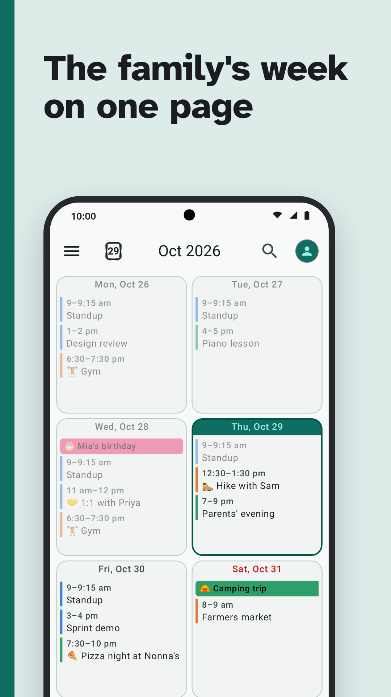</td>
<td>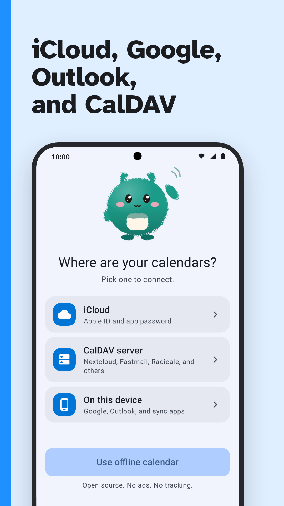</td>
<td></td>
<td>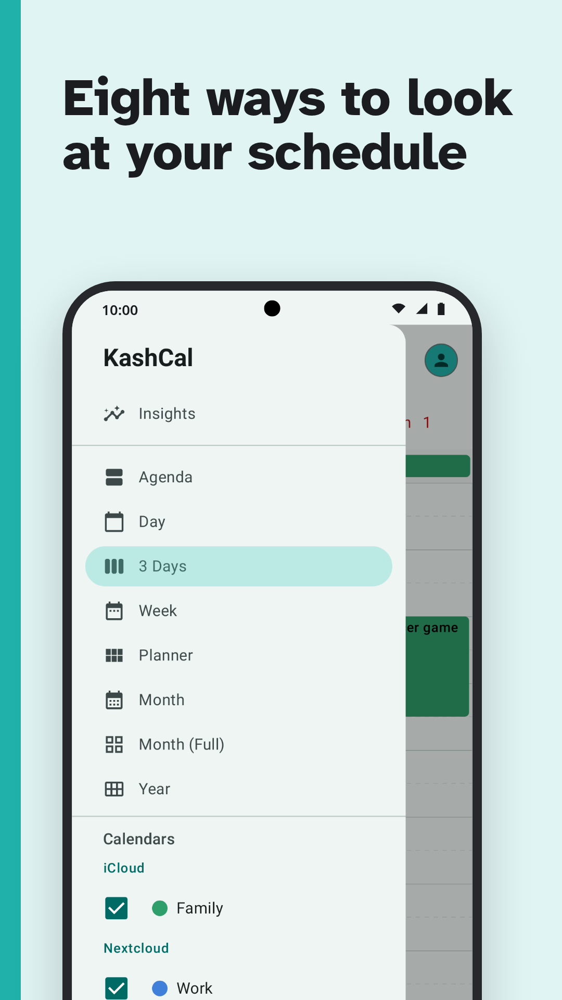</td>
</tr>
<tr>
<td>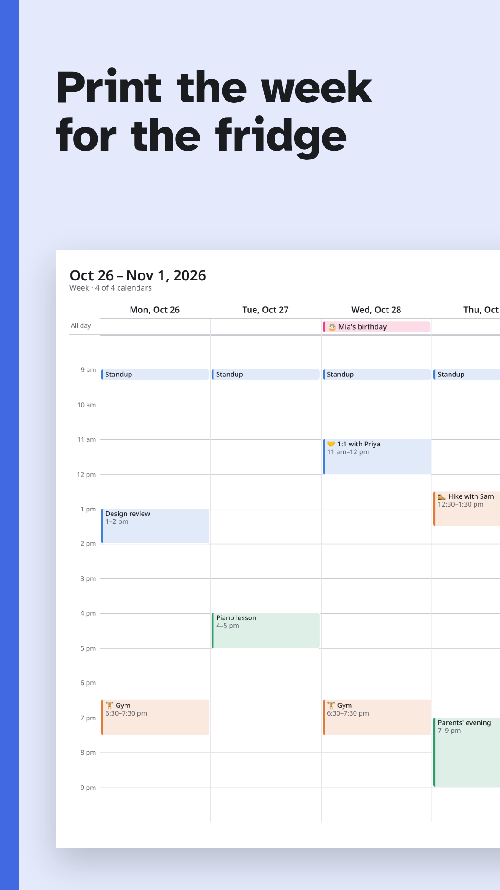</td>
<td>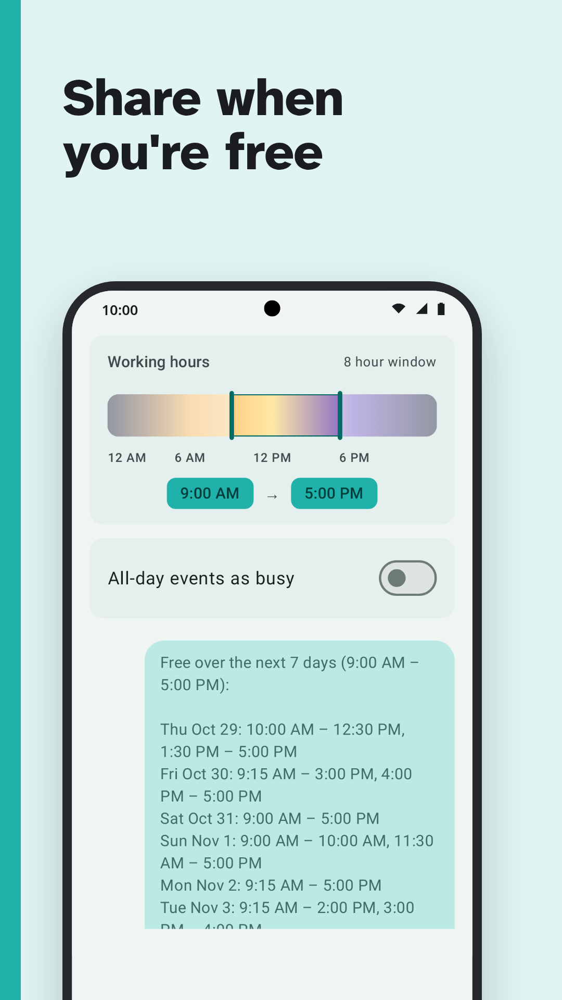</td>
<td>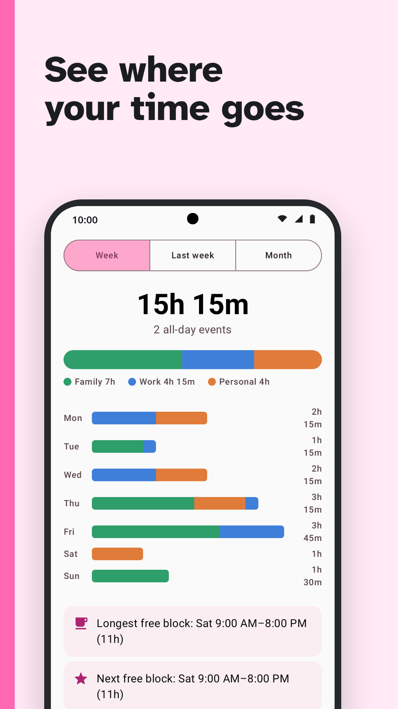</td>
<td>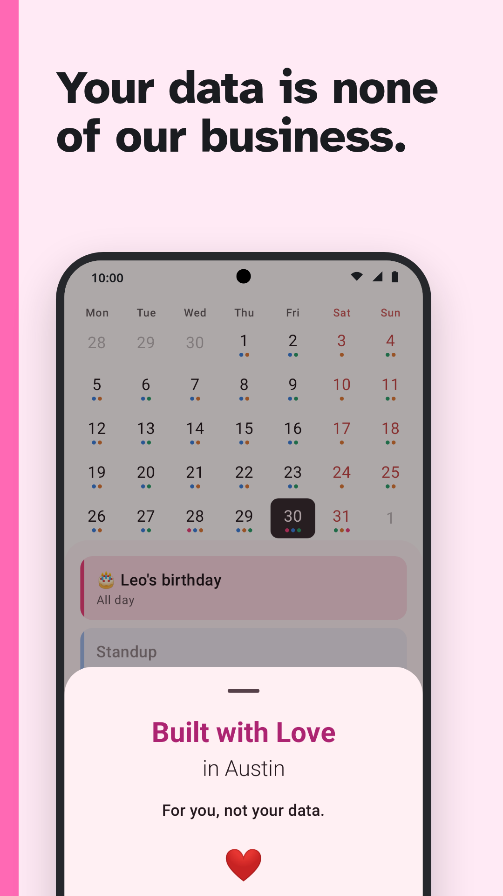</td>
</tr>
<tr>
<td>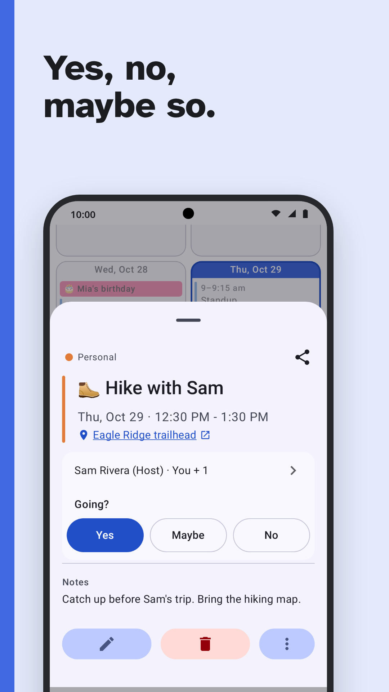</td>
<td>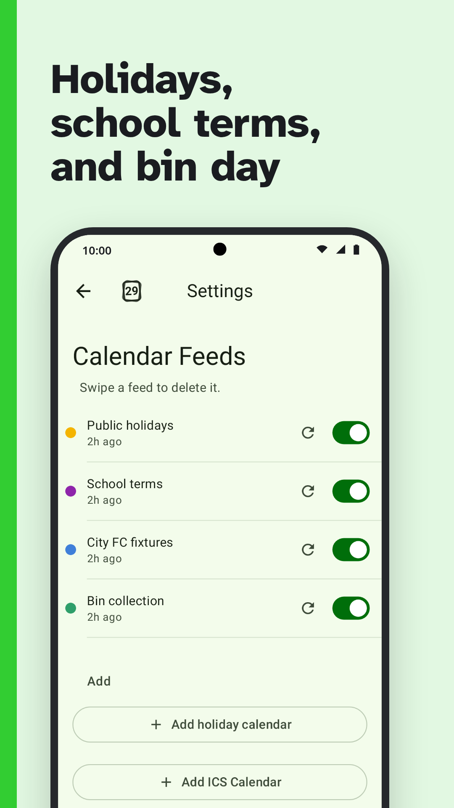</td>
<td>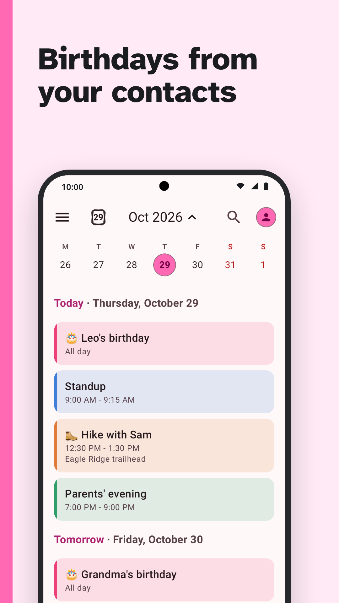</td>
<td>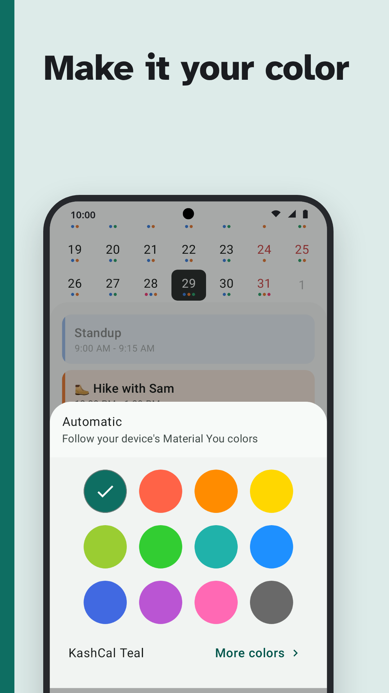</td>
</tr>
<tr>
<td>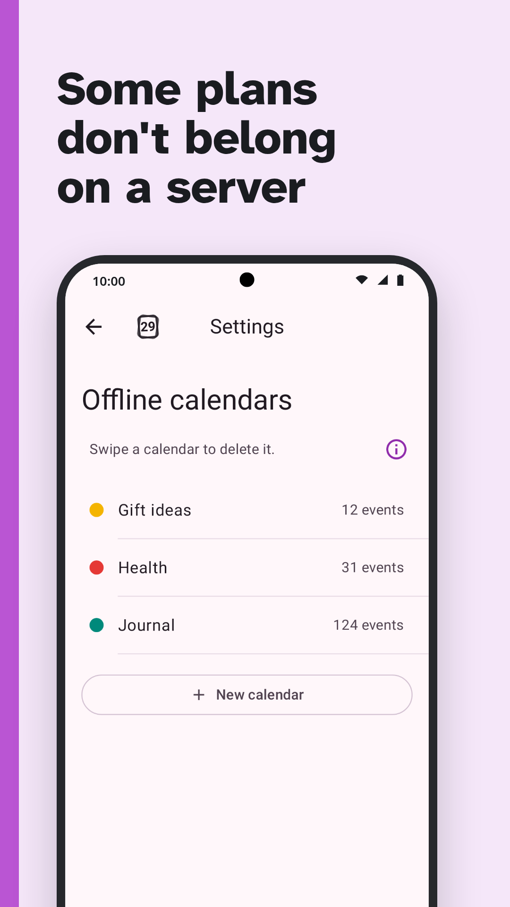</td>
<td>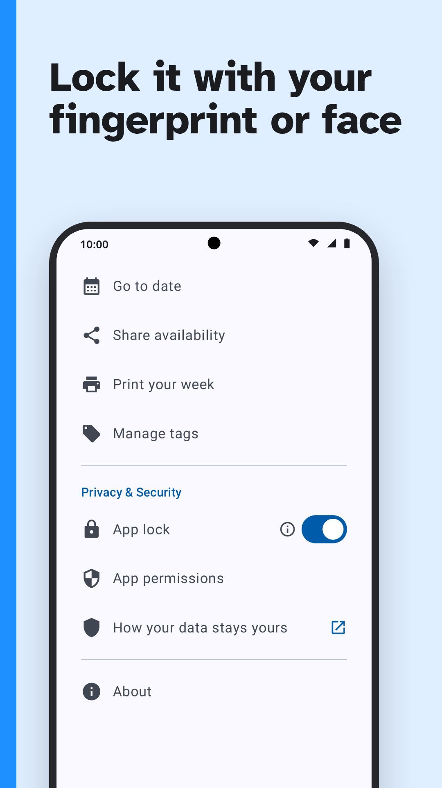</td>
<td>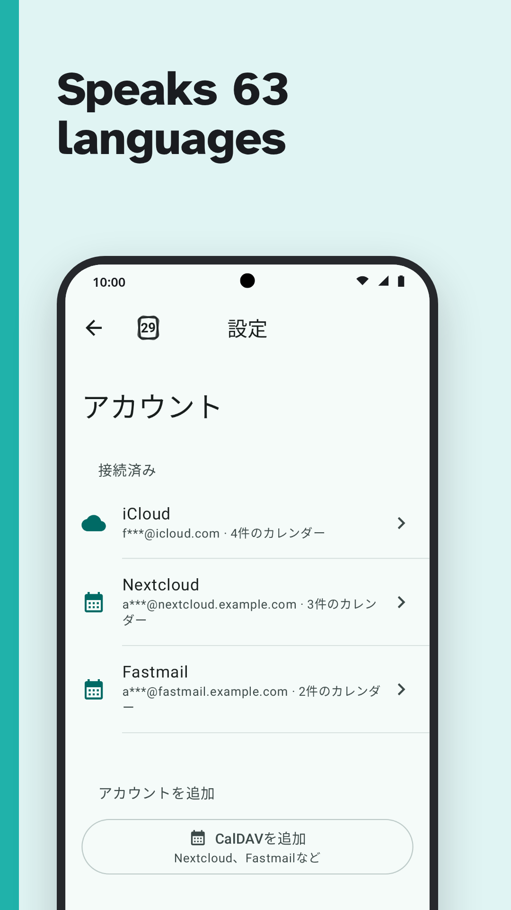</td>
</tr>
</table>

---

</div>

## Apresentação

O **Abacate Calendário** é uma central pessoal e privativa de produtividade para Android, inspirada na filosofia de integração transparente do ecossistema Apple Calendar. Em seu lançador de aplicativos, o app exibe o nome direto e minimalista **Calendário**.

O aplicativo unifica três dimensões essenciais do seu dia a dia em uma interface elegante desenvolvida em Material 3: seus eventos de calendário, seus afazeres do Tasks.org e alertas inteligentes de deslocamento em tempo real (Travel Time). Tudo isso sem anúncios, sem telemetria, sem contas proprietárias obrigatórias e com criptografia de ponta a ponta.

---

## Os Três Pilares

### 1. Calendários & Sincronização Privada (CalDAV / iCloud / Local)
- **Sincronização Nativa com iCloud**: Gerencie seus calendários e contatos do iCloud diretamente no Android, ideal para famílias com dispositivos mistos.
- **Suporte Abrangente a CalDAV**: Conexão nativa com Nextcloud, Radicale, Baïkal, Stalwart, Fastmail, Zoho, SOGo, Mailbox.org, Purelymail e servidores personalizados. Sem intermediários ou servidores proxy externos.
- **Calendário Nativo do Dispositivo**: Visualize e edite compromissos sincronizados por outros aplicativos no Android (Google Calendar, Microsoft Outlook corporativo, SilentSuite criptografado).
- **Contatos CardDAV & Aniversários**: Sincronização bidirecional de contatos com fotos e geração dinâmica de calendários de aniversários e comemorações.
- **Feeds e Assinaturas ICS**: Assine feriados nacionais, calendários escolares e calendários esportivos em formato iCalendar padrão.
- **100% Funcional Offline**: Não requer conexão nem conta de terceiros para ser utilizado como calendário pessoal autônomo.

### 2. Integração Transparente com Tasks.org
- **Visão Unificada de Produtividade**: Compromissos com hora marcada e afazeres coexistem na mesma linha do tempo, inspirando-se no comportamento fluido do Apple Calendar.
- **Fonte Única da Verdade**: Integração direta via `ContentProvider` oficial do [Tasks.org](https://github.com/tasks/tasks). O Abacate Calendário nunca persiste ou duplica suas tarefas no banco de dados Room interno, preservando a integridade absoluta dos seus afazeres.
- **Ações Imediatas**: Conclua tarefas diretamente pela visão de agenda ou pelo widget da tela inicial com um simples toque na caixa de seleção.
- **Controle Flexível**: Ative ou desative a integração com o Tasks.org nas configurações do aplicativo a qualquer momento.

### 3. Alertas Inteligentes de Deslocamento (Travel Time)
- **Estimativa de Trânsito em Tempo Real**: Cálculo de tempo de percurso até o local do seu compromisso utilizando motores abertos de navegação (OpenStreetMap / OSRM e GraphHopper).
- **Notificações "Hora de Sair"**: Receba avisos proativos calculados com antecedência para que você nunca se atrase para compromissos presenciais.
- **Múltiplos Modos de Transporte**: Calcule rotas e previsões de chegada para viagens de carro, transporte público, bicicleta ou a pé.

---

## Widgets Modernos para a Tela Inicial

- **Split Agenda Widget (Duas Colunas)**: Desenvolvido com Jetpack Glance, exibe seus eventos na coluna esquerda e seus afazeres do Tasks.org na coluna direita de forma equilibrada.
- **Destaque Diário Contínuo**: A seção **Hoje** é mantida visível com destaque imediato, mesmo quando não houver compromissos agendados.
- **Condensação Inteligente**: Para dias com volume intenso, tarefas e eventos de dia todo excedentes são resumidos em cartões compactos de contagem para manter sua tela inicial sempre limpa e organizada.
- **Material You Dinâmico**: Adaptação perfeita às cores do papel de parede do sistema e suporte total a temas claro e escuro.

---

## Privacidade e Segurança por Padrão

- **Sem Telemetria**: Sem rastreadores, sem bibliotecas analíticas e sem coleta de comportamento.
- **Modo Fort Knox**: Os dados dos seus eventos permanecem confinados ao aplicativo, inacessíveis a outros aplicativos do sistema.
- **Criptografia via Android Keystore**: Credenciais e senhas de contas são salvas com chave mestra no hardware do dispositivo utilizando cifragem AES-256-GCM.
- **HTTPS Estrito**: Conexões diretas e criptografadas com seus servidores, sem intermediários.
- **Bloqueio por Biometria**: Proteja o acesso ao aplicativo exigindo autenticação biométrica (impressão digital ou facial) ou PIN.

---

## Instalação e Atualização

### Método Recomendado: Obtainium

O [Obtainium](https://github.com/ImranR98/Obtainium) permite que você instale o aplicativo e receba atualizações automáticas diretamente dos releases deste repositório no GitHub, sem depender de lojas proprietárias ou intermediários comerciais.

1. Instale o aplicativo Obtainium no seu Android.
2. Toque no link direto abaixo para importar a configuração de 1-toque:

   👉 **[Adicionar Abacate Calendário no Obtainium](https://apps.obtainium.imranr.dev/redirect?r=obtainium://app/%7B%22id%22:%22org.onekash.kashcal.tasks%22,%22url%22:%22https://github.com/eusoumadson/abacate-calendario%22,%22author%22:%22eusoumadson%22,%22name%22:%22Abacate%20Calend%C3%A1rio%22%7D)**

*(Ou, no Obtainium, clique em "Add App" e cole a URL deste repositório: `https://github.com/eusoumadson/abacate-calendario`)*.

### Download Direto de APK

Você também pode baixar manualmente o pacote APK assinado mais recente acessando a página de [GitHub Releases](https://github.com/eusoumadson/abacate-calendario/releases).

> **Coexistência Lado a Lado:** O Abacate Calendário adota o identificador de pacote com sufixo `.tasks` (`org.onekash.kashcal.tasks`), permitindo que você o instale e utilize simultaneamente ao KashCal upstream no mesmo dispositivo, sem sobreposição de contas ou de dados.

---

## Créditos e Atribuição Upstream

O Abacate Calendário é um fork livre mantido com carinho por [@eusoumadson](https://github.com/eusoumadson) dentro do ecossistema pessoal *abacatelab*.

Expressamos nossa enorme admiração e reconhecimento aos seguintes projetos que tornaram este trabalho possível:

- **[KashCal](https://github.com/KashCal/KashCal)**: Criado com maestria pela equipe KashCal / [@one-kash](https://github.com/one-kash). O KashCal estabeleceu a arquitetura sólida de sincronização CalDAV/CardDAV, o motor de expansão de recorrências RFC 5545 (`icaldav-core`), e a experiência refinada em Jetpack Compose que serve como fundação indispensável deste aplicativo.
- **[Tasks.org](https://github.com/tasks/tasks)**: Desenvolvido por Alex Baker ([@abaker](https://github.com/abaker)), sendo a melhor e mais respeitada plataforma de gestão de tarefas de código aberto no ecossistema Android.

---

## Para Desenvolvedores

### Tecnologias Utilizadas

| Componente | Tecnologia |
|---|---|
| Interface de Usuário | Jetpack Compose, Material 3, Material You |
| Widgets | Jetpack Glance |
| CalDAV / iCalendar | `icaldav-core` (módulo in-tree, ical4j) |
| CardDAV / vCard | `vcard-core` (módulo in-tree, ez-vcard) |
| Banco de Dados | Room + FTS4 |
| Injeção de Dependências | Hilt |
| Assincronismo | Kotlin Coroutines + StateFlow |
| Tarefas em Segundo Plano | WorkManager |
| Rede HTTP | OkHttp |
| Segurança | Android Keystore (AES-256-GCM) |

### Compilação a partir do Código Fonte

Requisitos:
- Android SDK 37 (compilação e destino)
- JDK 21
- Gradle 9.8.2

```bash
git clone https://github.com/eusoumadson/abacate-calendario.git
cd abacate-calendario
./gradlew assembleDebug --no-daemon
./gradlew testDebugUnitTest --no-daemon
```

Para detalhes sobre diretrizes de contribuição, consulte [CONTRIBUTING.md](CONTRIBUTING.md). Para convenções de arquitetura, padrões de projeto e testes, consulte [AGENTS.md](AGENTS.md) e as notas de paridade do motor RRULE em [docs/RRULE_ENGINE_PARITY.md](docs/RRULE_ENGINE_PARITY.md).

---

<div align="center">

**[GitHub Releases](https://github.com/eusoumadson/abacate-calendario/releases)** · **[Issues](https://github.com/eusoumadson/abacate-calendario/issues)** · **[Upstream KashCal](https://github.com/KashCal/KashCal)**

Licença Apache 2.0 (veja [LICENSE](LICENSE) e [LICENSING.md](LICENSING.md))

</div>
