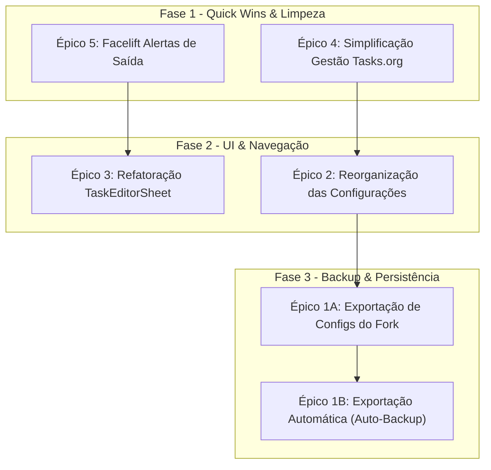

# Roadmap de Novas Features e Refatorações — KashCal Fork

> [!NOTE]
> **Status**: ✅ **Todas as Fases Concluídas** (Épicos 1 a 5 implementados na branch `main`).
> Todos os testes unitários (`./gradlew testDebugUnitTest`) foram corrigidos e passam com sucesso.
> Build validado e instalado no dispositivo físico (`RQ8N502VJ1M`).

---


Este documento detalha o planejamento arquitetural, escopo e estratégia de implementação para as próximas fases de evolução do fork do **KashCal**.

---

## 🎯 Visão Geral dos Objetivos

O foco desta nova fase é consolidar a maturidade das features exclusivas do fork:
1. **Resiliência e Portabilidade de Dados**: Exportação completa (incluindo configs do fork) e backup automatizado.
2. **Coesão e Design System**: Refatorar o formulário de tarefas e lapidar os alertas de saída para estarem 100% harmonizados com a linguagem visual padrão do app.
3. **Ergonomia e Navegação**: Reagrupar de forma semântica as features do fork nas configurações gerais.
4. **Foco e Desacoplamento**: Simplificar a gestão de listas do Tasks.org, removendo atritos e duplicações desnecessárias.

---

## 🗺️ Épicos do Roadmap



---

### Épico 1: Backup e Exportação Estendida de Configurações

#### 1.1 Exportação de Configurações do Fork
- **Diagnóstico Atual**:
  - A rotina de backup em [`SettingsBackupExporter.kt`](file:///Users/madsonsantana/kashcal_tasks/app/src/main/kotlin/org/onekash/kashcal/domain/backup/SettingsBackupExporter.kt) filtra estritamente as preferências por meio de [`ExportablePreferences.KEYS`](file:///Users/madsonsantana/kashcal_tasks/app/src/main/kotlin/org/onekash/kashcal/domain/backup/ExportablePreferences.kt#L70-L137).
  - Várias configurações do fork estão excluídas (`TASKS_ORG_ENABLED`, chaves de API do TomTom e Stadia, `HIDDEN_TASKS_ORG_LIST_IDS`) ou não registradas (`TASKS_IN_WIDGETS_ENABLED`, `EXPERIMENTAL_WIDGETS_ENABLED`).
- **Escopo e Implementação**:
  - Criar suporte no [`BackupEnvelope.kt`](file:///Users/madsonsantana/kashcal_tasks/app/src/main/kotlin/org/onekash/kashcal/domain/backup/BackupEnvelope.kt) para metadados ou campos estendidos do fork (`fork_preferences` ou inclusão retrocompatível).
  - Permitir a exportação dos seguintes parâmetros do fork:
    - **Tasks.org**: `tasks_org_enabled`, `tasks_in_widgets_enabled`, listas ocultadas.
    - **Alertas de Saída**: `travel_valhalla_enabled`, `travel_rush_hour_enabled`, `travel_tomtom_enabled`, `travel_stadia_enabled` e opção de exportar ou não as API keys (com alerta de privacidade).
    - **Widgets Experimentais**: `experimental_widgets_enabled`.
  - Diálogo de exportação atualizado: opção de "Exportação Completa (com recursos do Fork)" vs "Exportação Padrão Upstream".
  - Atualização dos testes unitários em [`ExportablePreferencesTest.kt`](file:///Users/madsonsantana/kashcal_tasks/app/src/test/kotlin/org/onekash/kashcal/domain/backup/ExportablePreferencesTest.kt) para manter integridade com as regras de reflexão do upstream.

#### 1.2 Exportação Automática das Configurações (Auto-Backup)
- **Escopo e Implementação**:
  - **Storage via SAF (Storage Access Framework)**:
    - O usuário seleciona uma pasta de destino usando `ActivityResultContracts.OpenDocumentTree()` com permissão persistente (`takePersistableUriPermission`).
    - Permite salvar diretamente no Google Drive, Nextcloud ou armazenamento interno/SD Card.
  - **Mecanismo Agendado via WorkManager**:
    - `PeriodicWorkRequest` com periodicidade configurável (Diária, Semanal ou Mensal).
    - Execução restrita a condições ideais (bateria não fraca, dispositivo ocioso, e.g. madrugada).
  - **Política de Retenção (Rotation / Pruning)**:
    - Rotação automática mantendo os últimos *N* backups (ex: últimos 5 backups: `kashcal_backup_auto_YYYY-MM-DD_HHmmss.json`).
  - **Interface de Configuração**:
    - Nova seção em *Configurações > Backup e Restauração*:
      - Switch "Backup automático de configurações".
      - Seletor de diretório de destino.
      - Frequência (Diário / Semanal).
      - Indicador de status: "Último backup realizado em: [Data e Hora]".

---

### Épico 2: Re-arranjo das Áreas de Features do Fork

#### Diagnóstico Atual
Hoje as 3 features exclusivas do fork estão aninhadas dentro da seção **"Calendários e contas"** (`settings_section_calendars`) em [`AccountSettingsScreen.kt`](file:///Users/madsonsantana/kashcal_tasks/app/src/main/kotlin/org/onekash/kashcal/ui/screens/AccountSettingsScreen.kt#L510-L556):
1. **Tarefas do Tasks.org** (`tasks-org`)
2. **Alertas de Saída** (`travel-alerts`)
3. **Widgets Experimentais** (`experimental-widgets`)

Isso causa sobrecarga conceitual: "Calendários e contas" existe para protocolos CalDAV/Google/Exchange e provedores de eventos. Alertas de deslocamento são regras de notificação inteligente, e Widgets são extensões da tela inicial.

#### Proposta de Agrupamento Recomendada

| Feature | Local Atual | Novo Agrupamento Recomendado | Justificativa |
|---|---|---|---|
| **Tarefas do Tasks.org** | Calendários e contas | **Nova Seção: "Integrações e Tarefas"** (ou "Fontes de Dados & Tarefas") | O Tasks.org é um provedor de dados externo completo (tarefas, listas, lembretes). Mantém destaque sem poluir a lista de calendários puros. |
| **Alertas de Saída** | Calendários e contas | **Seção "Criação de Eventos"** (ou nova seção de **"Notificações e Deslocamento"**) | É uma funcionalidade diretamente atrelada aos eventos e seus lembretes (calcula tempo de viagem até o local do compromisso). |
| **Widgets Experimentais** | Calendários e contas | **Seção "Aparência" (subseção Widgets)** | O upstream já possui configurações de widget em Aparência (`widget_color_source`, etc.). Widgets pertencem nativamente à personalização visual e launcher. |

> [!TIP]
> **Opção Alternativa (Menor atrito de rebase):**
> Criar uma seção própria e isolada chamada **"Recursos Avançados (KashCal+)"** ou **"Recursos do Fork"** que encapsule os 3 cards em um único ponto. Isso minimiza toques no código do upstream para facilitar futuros rebases.

---

### Épico 3: Refatoração Visual do Formulário de Tarefas (TaskEditorSheet)

#### Diagnóstico Atual
- [`TaskEditorSheet.kt`](file:///Users/madsonsantana/kashcal_tasks/app/src/main/kotlin/org/onekash/kashcal/ui/components/TaskEditorSheet.kt) foi construído como um `ModalBottomSheet` simples com `BottomSheetDefaults.DragHandle()`, botões no rodapé e espaçamentos utilitários básicos.
- O formulário padrão do app ([`EventFormSheet.kt`](file:///Users/madsonsantana/kashcal_tasks/app/src/main/kotlin/org/onekash/kashcal/ui/components/EventFormSheet.kt)) usa uma janela de tela cheia/Dialog polida, barra de ações superior com título centralizado, botão pill arredondado (`RoundedCornerShape(20.dp)`), tratamento de cores de contraste e blocos bem definidos.

#### Plano de Refatoração Visual
1. **Estrutura de Top Bar Padronizada**:
   - Substituir botões de rodapé por TopBar:
     - Botão à esquerda: "Cancelar" (com confirmação de descarte de alterações caso o form tenha sido modificado).
     - Centro: Título em destaque ("Nova tarefa" / "Editar tarefa").
     - Botão à direita: Botão pill de "Salvar", estilizado com a cor da lista selecionada e texto em contraste.
2. **Organização em Blocos e Espaçamentos**:
   - Campo de Título sem bordas pesadas, focado e expansivo.
   - Bloco de Notas/Descrição harmonizado com o campo de descrição de evento.
   - Seletores de Data de Vencimento e Data de Início estilizados com ícones alinhados à esquerda (ícone de calendário/relógio).
   - Sessão de Prioridade e Tags com chips compactos seguindo a paleta do Material 3 do app.
   - Alinhamento de margens para `16.dp` padrão.
3. **Comportamento e Teclado**:
   - Janela `Dialog` com `safeDrawingPadding` e `decorFitsSystemWindows = false` para subida fluida do teclado virtual (IME).

---

### Épico 4: Simplificação da Integração do Tasks.org

#### Diagnóstico Atual
- Em [`TasksOrgManagementSection.kt`](file:///Users/madsonsantana/kashcal_tasks/app/src/main/kotlin/org/onekash/kashcal/ui/screens/settings/TasksOrgManagementSection.kt), existem sessões completas para:
  - Gerenciar Tags (renomear, alterar cor, excluir).
  - Gerenciar Lugares (listar, excluir).
  - Gerenciar Listas (criar via botão externo, renomear, colorir, excluir).
- Tags e lugares já são gerenciados com maestria pelo próprio app Tasks.org. Ter manutenção parcial dessas entidades dentro do KashCal adiciona complexidade, risco de dessincronização e poluição visual.

#### Alterações Planejadas
1. **Remoção de Tags e Lugares**:
   - Remover as seções `tasks_org_manage_tags` e `tasks_org_manage_places`.
   - Limpar diálogos de edição/exclusão de tags e lugares.
2. **Restrição das Listas**:
   - **Manter apenas a edição**: Permitir exclusivamente renomear e alterar a cor da lista existente.
   - **Remover exclusão de listas**: Eliminar ação/botão de apagar lista (`Deletion.OfList`).
   - **Remover criação de listas**: Remover botão de criar lista no app externo (`tasks_org_create_list_in_app`).
3. **Limpeza Técnica**:
   - Ajustar [`TasksOrgManageViewModel.kt`](file:///Users/madsonsantana/kashcal_tasks/app/src/main/kotlin/org/onekash/kashcal/ui/viewmodels/TasksOrgManageViewModel.kt), descontinuando métodos de mutação de tags e lugares que não serão mais chamados pela UI.

---

### Épico 5: Facelift e Pente Fino nos Alertas de Saída (Travel Alerts)

#### Diagnóstico Atual em [`TravelAlertsScreen.kt`](file:///Users/madsonsantana/kashcal_tasks/app/src/main/kotlin/org/onekash/kashcal/ui/screens/settings/TravelAlertsScreen.kt)
1. **Header Incorreto**:
   - Linha 254 usa `stringResource(R.string.settings_tasks_org_enabled)` como título da seção de provedores (exibindo string indevida no português).
2. **Strings Hardcoded**:
   - Badge "Always active" (linha 370) sem tradução em strings.xml.
   - Hint "stadiamaps API key" (linha 285) hardcoded.
3. **Tags/Badges com Espaçamento e Estilo Inconsistentes**:
   - Permissões: `RoundedCornerShape(16.dp)`, padding `horizontal = 10.dp, vertical = 4.dp`, cor verde manual (`0xFF2E7D32`).
   - Status do Circuit Breaker: `RoundedCornerShape(12.dp)`, padding `horizontal = 8.dp, vertical = 2.dp`, cor laranja manual (`0xFFF57C00`).
   - Local Offline: `RoundedCornerShape(12.dp)`, `primaryContainer`.
4. **Layout dos Cards**:
   - Variação arbitrária de `Arrangement.spacedBy(10.dp)` vs `12.dp`.

#### Ações de Melhoria
- **Componente Unificado de Status (`TravelStatusBadge`)**:
  - Criar um badge padrão com cantos de `8.dp` ou `12.dp`, padding uniforme (`horizontal = 8.dp, vertical = 4.dp`) e cores dinâmicas baseadas em tokens semânticos do M3 (`tertiaryContainer`, `errorContainer`, etc.) em vez de cores hexadecimais fixas.
- **Harmonização com Linhas Padrão de Configurações**:
  - Alinhar tipografia com os títulos de `SettingsRow` do KashCal.
  - Corrigir os cabeçalhos de seção com a tipografia padrão de `NestedSettingsHeading`.
- **Internacionalização Completa**:
  - Mapear todas as strings para `values/strings.xml` e `values-pt-rBR/strings.xml`.

---

## 📅 Plano de Execução Sugerido

```mermaid
flowchart LR
    subgraph Sprint 1
        A1["Limpeza Tasks.org (Épico 4)"]
        A2["Pente fino Alertas (Épico 5)"]
    end
    subgraph Sprint 2
        B1["Refatoração TaskEditorSheet (Épico 3)"]
        B2["Reorganização Settings (Épico 2)"]
    end
    subgraph Sprint 3
        C1["Exportação Configs Fork (Épico 1A)"]
        C2["Auto-Backup WorkManager (Épico 1B)"]
    end

    Sprint 1 --> Sprint 2 --> Sprint 3
```

### Sprint 1: Polish & Limpeza (Baixo Risco, Alto Retorno Visual)
- [x] Executar Épico 4: Limpar tags, lugares e restringir listas em [`TasksOrgManagementSection.kt`](file:///Users/madsonsantana/kashcal_tasks/app/src/main/kotlin/org/onekash/kashcal/ui/screens/settings/TasksOrgManagementSection.kt).
- [x] Executar Épico 5: Corrigir strings, badges e espaçamentos em [`TravelAlertsScreen.kt`](file:///Users/madsonsantana/kashcal_tasks/app/src/main/kotlin/org/onekash/kashcal/ui/screens/settings/TravelAlertsScreen.kt).

### Sprint 2: Design System & Arquitetura de Telas
- [x] Executar Épico 3: Reestruturar [`TaskEditorSheet.kt`](file:///Users/madsonsantana/kashcal_tasks/app/src/main/kotlin/org/onekash/kashcal/ui/components/TaskEditorSheet.kt) com base no layout de [`EventFormSheet.kt`](file:///Users/madsonsantana/kashcal_tasks/app/src/main/kotlin/org/onekash/kashcal/ui/components/EventFormSheet.kt).
- [x] Executar Épico 2: Definir e migrar a navegação das 3 features do fork para seu novo agrupamento em [`AccountSettingsScreen.kt`](file:///Users/madsonsantana/kashcal_tasks/app/src/main/kotlin/org/onekash/kashcal/ui/screens/AccountSettingsScreen.kt).

### Sprint 3: Backup & Resiliência
- [x] Executar Épico 1A: Expandir schema e serialização do [`BackupEnvelope.kt`](file:///Users/madsonsantana/kashcal_tasks/app/src/main/kotlin/org/onekash/kashcal/domain/backup/BackupEnvelope.kt) com configs do fork.
- [x] Executar Épico 1B: Implementar serviço de auto-backup agendado com `WorkManager` e seletor SAF.


---

## 🚀 Próximos Horizontes & Laboratório de IA Agentica

Com a conclusão dos 5 épicos de código, as próximas etapas focam no laboratório de **Spec-Driven Development** e **Loop Engineering**:

1. **Homologação em Hardware Real**:
   - Executar o roteiro de testes de alertas de saída em dispositivo: [`TRAVEL_TIME_DEVICE_TEST.md`](file:///Users/madsonsantana/kashcal_tasks/TRAVEL_TIME_DEVICE_TEST.md).
   - Executar o roteiro de testes do Tasks.org em dispositivo: [`TASKS_ORG_DEVICE_TEST.md`](file:///Users/madsonsantana/kashcal_tasks/TASKS_ORG_DEVICE_TEST.md).
2. **Ciclos de Mudança com OpenSpec (`/opsx:propose` e `/opsx:apply`)**:
   - Estruturar novas melhorias e correções como mudanças isoladas em `openspec/changes/<change-name>/`.
3. **Loop Engineering com Ralph**:
   - Configurar o adaptador ou fluxo de execução do `ralph` com `agy-cli` e validação mecânica (`--test-cmd "./gradlew :app:testDebugUnitTest"`).
