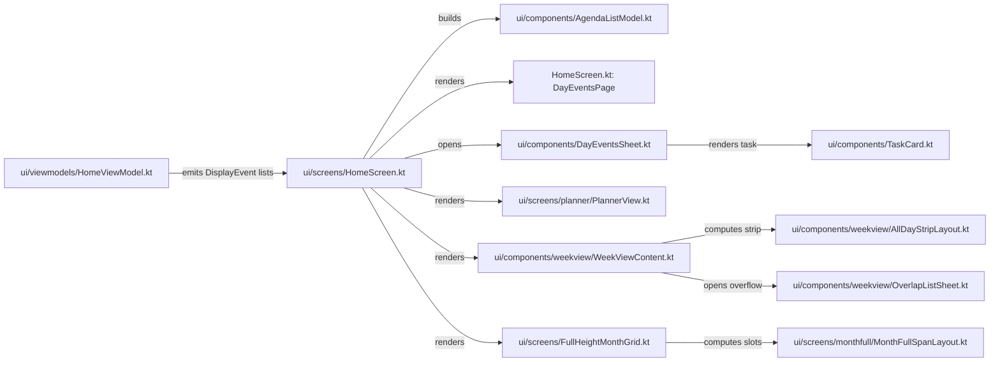
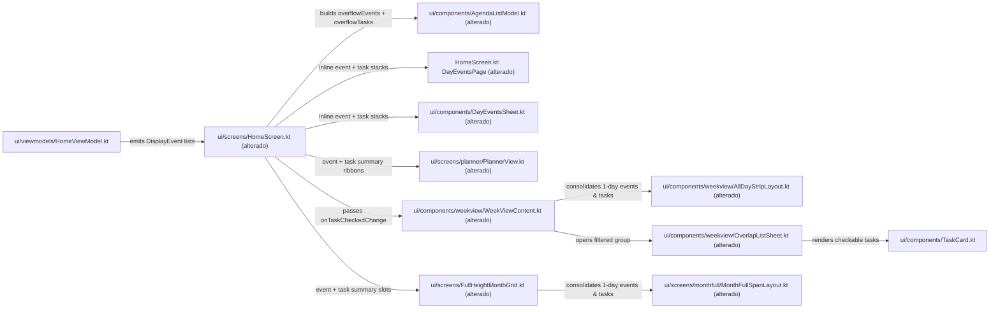

# Design & Technical Plan

## Context & Architecture Grounding

O objetivo desta mudança (`all-day-stacking-views`) é unificar o empilhamento e a consolidação de eventos de dia todo (`!isTask && isAllDay`) e tarefas de dia todo (`DisplayEvent.Task` com `isAllDay == true`) em todas as visões de calendário do aplicativo, conforme detalhado em `proposal.md` e na especificação delta `openspec/changes/all-day-stacking-views/specs/tasks-org-integration/spec.md`.

### Fontes de Arquitetura Consultadas e Regras Impostas
- `AGENTS.md` e `docs/agents/architecture.md`:
  - **Fluxo Unidirecional Estrito (UI → Domain → Data)**: As telas e componentes em `app/src/main/kotlin/org/onekash/kashcal/ui/` operam exclusivamente sobre a sealed interface `DisplayEvent` (`DisplayEvent.Room`, `DisplayEvent.Device`, `DisplayEvent.Task`) já agregada por `DisplayEventRepository` e exposta via `HomeViewModel`. Nenhuma lógica de UI deve acessar DAOs do Room ou o `ContentResolver` diretamente.
- `docs/agents/domain_rules.md`:
  - **Não-Persistência e Gate do Tasks.org**: `DisplayEvent.Task` nunca é persistido no Room e sua presença nas coleções de UI já é controlada por `DisplayEventRepository.queryTaskEvents` (`if (!dataStore.getTasksOrgEnabled()) return emptyList()`) e pelo `StateFlow` `HomeViewModel.tasksOrgEnabled`. O empilhamento de eventos de dia todo (`DisplayEvent.Room` e `DisplayEvent.Device`) funciona independentemente do toggle `tasksOrgEnabled`.
  - **Eventos Multi-dia vs. 1 Dia**: Nas visões em grade (`PlannerView`, `AllDayStripLayout`/`WeekViewContent`, `MonthFullSpanLayout`/`FullHeightMonthGrid`), eventos que cruzam múltiplos dias (`startDay != endDay`) são renderizados como barras horizontais contínuas (`AllDaySpan`, `WeekSpan`, `PlannerRibbon` com flush) e não devem ser colapsados nos chips/ribbons de resumo de 1 único dia (`startDay == endDay`). Na Agenda (`AgendaListModel`), eventos multi-dia já são expandidos em 1 `AgendaDisplayItem` por dia coberto ("Dia X de Y") antes do agrupamento diário.
- `docs/agents/coding_guidelines.md` e `docs/fork/FORK_INTEGRATION.md`:
  - **Isolamento de Enxerto do Fork**: Todo toque em arquivos de core para suportar o empilhamento e a integração de tarefas deve carregar o comentário `// FORK:tasks-org` e ser documentado em `docs/fork/FORK_INTEGRATION.md`.
  - **Disciplina de Recursos e Acessibilidade**: Nenhuma string visível ao usuário pode ser hardcoded em Kotlin/Compose. Novas strings devem ser declaradas em `app/src/main/res/values/strings.xml` e sincronizadas em `app/src/main/res/values-pt/strings.xml` e `app/src/main/res/values-pt-rBR/strings.xml` por meio de `app/src/fork/tools/gen_strings_pt.py`.
  - **Testes Unitários Determinísticos em UTC**: Os modelos puros de layout (`AgendaListModel`, `AllDayStripLayout`, `MonthFullSpanLayout`) e os testes Compose/Robolectric (`PlannerViewTest`, `DayEventsSheet`, `WeekViewContent`) devem passar sob `./gradlew testDebugUnitTest --no-daemon` com timezone UTC fixado.

## Goals / Non-Goals

**Goals:**
- Estender o padrão de colapse inline (1º item visível + card expansível `+X`) para eventos de dia todo (`!isTask && isAllDay`) e tarefas de dia todo (`isTask && isAllDay`) nas três superfícies de lista: Agenda (`AgendaListModel.kt`, `HomeScreen.kt`), Mês (`DayEventsPage` em `HomeScreen.kt`) e Drawer/Bottom Sheet de Dia (`DayEventsSheet.kt`).
- Consolidar múltiplos (`> 1`) eventos de dia todo de 1 único dia (`startDay == endDay`) em 1 único elemento de resumo nas visões baseadas em grade/célula — Planejador (`PlannerView.kt`), Dia/3 Dias/Semana (`AllDayStripLayout.kt`, `WeekViewContent.kt`) e Mês Completo (`MonthFullSpanLayout.kt`, `FullHeightMonthGrid.kt`) — e consolidar múltiplas (`> 1`) tarefas de dia todo na faixa de Dia/3 Dias/Semana e no Mês Completo, exibindo o item individualmente quando `== 1`.
- Permitir que o toque em um chip de agrupamento (de eventos ou de tarefas) na faixa de dia todo das visões Dia, 3 Dias e Semana abra `OverlapListSheet.kt` exibindo exclusivamente os itens daquele agrupamento, com suporte a `TaskCard` (checkbox interativo `OnTaskCheckedChange`) e abertura do `QuickViewSheet` correspondente.

**Non-Goals:**
- Alterar os widgets Glance (`SplitAgendaWidgetContent.kt`, `AgendaWidget`), que já implementam o empilhamento de eventos e tarefas de dia todo.
- Modificar `DisplayEventRepository.kt`, `TasksOrgCoordinator.kt`, entidades/DAOs do Room ou sincronização CalDAV.
- Agrupar eventos multi-dia (`startDay != endDay`) nos chips/slots de resumo das visões em grade (eles permanecem em `AllDaySpan` / `WeekSpan`).

## AS IS — Estado e Componentes Atuais

Atualmente, `AgendaListModel.kt`, `DayEventsSheet.kt`, `PlannerView.kt` e `MonthFullSpanLayout.kt` empilham ou consolidam apenas tarefas de dia todo (`DisplayEvent.Task`), deixando múltiplos eventos de dia todo desagrupados; além disso, `DayEventsPage` (`HomeScreen.kt`) e `AllDayStripLayout.kt` (`WeekViewContent.kt` / `OverlapListSheet.kt`) não empilham nem eventos nem tarefas de dia todo por categoria.

## TO BE — Estado e Componentes Propostos

Os componentes marcados como `(alterado)` implementam o empilhamento inline de eventos e tarefas de dia todo na Agenda (`RF-03` — `T02`, `T03`), na visão Mês `DayEventsPage` (`RF-06` — `T03`) e no `DayEventsSheet` (`RF-07` — `T04`), bem como a consolidação em resumos por categoria no Planejador (`RF-04` — `T05`), no Mês Completo (`RF-04` — `T06`) e na faixa de dia todo das visões Dia/3 Dias/Semana com `OverlapListSheet` filtrado (`RF-08` — `T07`), mantendo isolamento de fork e localização (`RNF-01` — `T01`, `T08`).

## Decisões Técnicas (RIGID vs FLEXIBLE)

### RIGID (Invariantes e Contratos Inegociáveis)
- **R1 — Regra de Limiar `> 1` vs `== 1` (`RF-03`, `RF-04`, `RF-06`, `RF-07`, `RF-08`)**:
  - Em qualquer visão, um card de pilha (`+X`) ou chip/slot/ribbon consolidado só pode existir quando a contagem de itens elegíveis da categoria naquele dia/coluna for estritamente `> 1`. Quando houver `0` itens nada é exibido; quando houver exatamente `1` item, ele é renderizado diretamente como card/chip/ribbon/slot normal.
- **R2 — Preservação de `headerIndexByDayCode` na Agenda (`RF-03`)**:
  - Em `AgendaDayGroup` (`AgendaListModel.kt`), adicionar `val overflowEvents: List<AgendaDisplayItem> = emptyList()`. Quando um dia tiver `> 1` evento de dia todo (`!isTask && isAllDay`), apenas o 1º permanece em `items` e os `N - 1` restantes vão para `overflowEvents`.
  - No cálculo de `headerIndexByDayCode` (`AgendaListModel.kt:95`), cada pilha não vazia (`overflowEvents.isNotEmpty()` e `overflowTasks.isNotEmpty()`) soma exatamente `+1` item ao índice flat do `LazyColumn`, mantendo correspondência 1:1 com os blocos `item(key = ...)` emitidos em `AgendaContent` (`HomeScreen.kt`) para que `resolveScrollTargetIndex` nunca desalinhe a rolagem da barra semanal.
- **R3 — Estado de Expansão Independente entre Eventos e Tarefas (`RF-03`, `RF-06`, `RF-07`)**:
  - Na Agenda (`AgendaContent`), na visão Mês (`DayEventsPage`) e no `DayEventsSheet`, o estado de expansão da pilha de eventos de dia todo (`expandedEventDays` / `isEventsExpanded`) deve ser independente do estado de expansão da pilha de tarefas de dia todo (`expandedTaskDays` / `isTasksExpanded`). Expandir ou recolher uma categoria não altera a outra.
- **R4 — Elegibilidade de Eventos de 1 Dia vs. Multi-dia nas Grades (`RF-04`, `RF-08`)**:
  - Em `PlannerDayBody` (`PlannerView.kt`), `computeAllDayStripRender` (`AllDayStripLayout.kt`) e `computeMonthFullWeekRender` (`MonthFullSpanLayout.kt`), apenas eventos de dia todo de 1 único dia (`it !is DisplayEvent.Task && it.isAllDay && it.startDay == it.endDay`) entram na consolidação de eventos quando `> 1`. Eventos multi-dia (`startDay != endDay`) permanecem como `PlannerRibbon` / `AllDaySpan` / `WeekSpan`.
- **R5 — Agrupamento Separado na Faixa de Dia Todo e `OverlapListSheet` Filtrado (`RF-08`)**:
  - Em `AllDayStripLayout.kt`, adicionar variantes dedicadas ou metadados em `AllDaySlot` (ex.: `AllDaySlot.EventGroupSummary(val events: List<DisplayEvent>)` e `AllDaySlot.TaskGroupSummary(val tasks: List<DisplayEvent.Task>)` ou `AllDaySlot.GroupSummary(val items: List<DisplayEvent>, val isTaskGroup: Boolean)`) para representar `> 1` evento de dia todo de 1 dia (em 1 único slot da coluna) e `> 1` tarefa de dia todo (em 1 único slot da coluna).
  - Clicar em um chip de agrupamento de eventos passa apenas a lista daqueles eventos para `OverlapListSheet`; clicar em um chip de agrupamento de tarefas passa apenas a lista daquelas tarefas para `OverlapListSheet`.
  - `OverlapListSheet` deve receber `onTaskCheckedChange: OnTaskCheckedChange? = null` (repassado desde `HomeScreen.kt` -> `WeekViewContent.kt` -> `OverlapListSheet.kt`) e renderizar `TaskCard` quando o item for `DisplayEvent.Task` e `onTaskCheckedChange != null`, permitindo concluir a tarefa pelo checkbox ou tocar no card para abrir o `TaskQuickViewSheet` e fechar o sheet.
- **R6 — Slots Consolidados no Mês Completo (`RF-04`, `AC-06`)**:
  - Em `MonthFullSpanLayout.kt` (`computeMonthFullWeekRender`) e `FullHeightMonthGrid.kt`, quando uma célula tiver `> 1` evento de dia todo de 1 único dia (`!isTask && isAllDay`), eles ocupam no máximo 1 slot na célula (representado por um slot de resumo com a contagem total de eventos de dia todo de 1 dia daquela célula, contabilizando os `N - 1` excedentes ou ocultando conforme o espaço de linhas da célula) e quando tiver `> 1` tarefa de dia todo (`isTask && isAllDay`), elas ocupam no máximo 1 slot de resumo de tarefas na célula. Quando `== 1`, o próprio evento ou tarefa é exibido normalmente via `SlotContent.CellEvent`.
- **R7 — Gating e Marcação do Fork (`RNF-01`)**:
  - Todas as adições em arquivos de core devem conter `// FORK:tasks-org`, atualizar `docs/fork/FORK_INTEGRATION.md`, e todas as strings novas devem ser adicionadas em `app/src/main/res/values/strings.xml` e sincronizadas em `values-pt/strings.xml` e `values-pt-rBR/strings.xml` via `python3 app/src/fork/tools/gen_strings_pt.py`.

### FLEXIBLE (Detalhes de Implementação Interna)
- **F1 — Reutilização de Componente Visual de Pilha Inline**:
  - `AgendaTaskStackCard` em `HomeScreen.kt` e o card expansível em `DayEventsSheet.kt` podem compartilhar um composable interno parametrizado pelo ícone (`Icons.Default.DateRange` / `Icons.Default.Event` para eventos, `Icons.Default.Check` para tarefas) ou definir `AgendaEventStackCard` ao lado de `AgendaTaskStackCard`.
- **F2 — Representação de `SlotContent` e `AllDaySlot` para Resumos**:
  - Em `MonthFullSpanLayout.kt`, `SlotContent` pode adicionar `data class EventSummary(val events: List<DisplayEvent>) : SlotContent` e `data class TaskSummary(val tasks: List<DisplayEvent.Task>) : SlotContent` (ou manter o 1º item com contagem associada para `FullHeightMonthGrid.kt` renderizar o rótulo compacto de resumo), desde que `shownEvents(col)` e `hiddenCounts[col]` mantenham a semântica esperada pelos leitores de tela e testes existentes.
- **F3 — Título do Header em `OverlapListSheet`**:
  - Quando todos os itens exibidos em `OverlapListSheet` forem `DisplayEvent.Task`, o cabeçalho pode exibir a contagem de tarefas (`label_more_tasks_compact` / equivalente) ou manter `status_events_count` se misto, mantendo compatibilidade com os testes de overflow da grade de horários.

## Risks & Rollback Matrix

| Risk | Blast Radius | Mitigation | Rollback |
| --- | --- | --- | --- |
| Desalinhamento de índices em `headerIndexByDayCode` na Agenda ao ter pilhas de eventos e de tarefas no mesmo dia | Rolagem ao tocar na barra semanal (`AgendaWeekBar`) cai no dia errado | Garantir em `buildAgendaListModel` que `overflowCardCount = (if (group.overflowEvents.isNotEmpty()) 1 else 0) + (if (group.overflowTasks.isNotEmpty()) 1 else 0)` e que `AgendaContent` emita exatamente 1 `item` no `LazyColumn` para cada pilha não vazia; cobrir com teste unitário em `AgendaListModelTest.kt`. | Reverter alterações em `AgendaListModel.kt` e `AgendaContent` (`HomeScreen.kt`). |
| Quebra de invariantes de `PlannerFitColumn` ou `MonthFullSpanLayoutTest` ao consolidar itens de 1 dia | Falha em testes de medição/layout (`PlannerViewTest`, `MonthFullSpanLayoutTest`) | Preservar eventos multi-dia (`startDay != endDay`) intactos em `computeWeekSpans` e nos ribbons individuais do Planejador; aplicar consolidação apenas quando `size > 1` para itens `startDay == endDay`. | Reverter os blocos marcados com `// FORK:tasks-org` em `PlannerView.kt`, `MonthFullSpanLayout.kt` e `FullHeightMonthGrid.kt`. |
| Conflito entre agrupamento de 1 dia e overflow de linhas (`+N`) em `AllDayStripLayout` | Faixa de dia todo nas visões Dia/3 Dias/Semana omite itens ou exibe contagem incorreta quando `allDayRowsExpanded == false` | Consolidar primeiro os eventos de 1 dia (`> 1` -> 1 slot de grupo) e tarefas de dia todo (`> 1` -> 1 slot de grupo) na lista de candidatos da coluna antes de alocar `freeSlots`; se um slot de grupo cair em `overflowByColumn` (ex.: linha única ocupada por barra multi-dia), expandir seus itens em `ColumnOverflow.events`. | Reverter alterações em `AllDayStripLayout.kt`, `WeekViewContent.kt` e `OverlapListSheet.kt`. |
| Divergência de traduções PT/PT-BR em `strings.xml` | Falha no check de strings ou textos em inglês na UI em português | Adicionar chaves em `app/src/main/res/values/strings.xml` e atualizar `app/src/fork/tools/gen_strings_pt.py`, executando `python3 app/src/fork/tools/gen_strings_pt.py` e `--check`. | Reverter commits nos arquivos `strings.xml` e `gen_strings_pt.py`. |

## Open Questions

Nenhuma questão em aberto ou conflito arquitetural. Todos os requisitos (`RF-03`, `RF-04`, `RF-06`, `RF-07`, `RF-08`, `RNF-01`) e critérios de aceite (`AC-01` a `AC-07`) estão alinhados com a arquitetura de camadas e com as regras de isolamento do fork.
