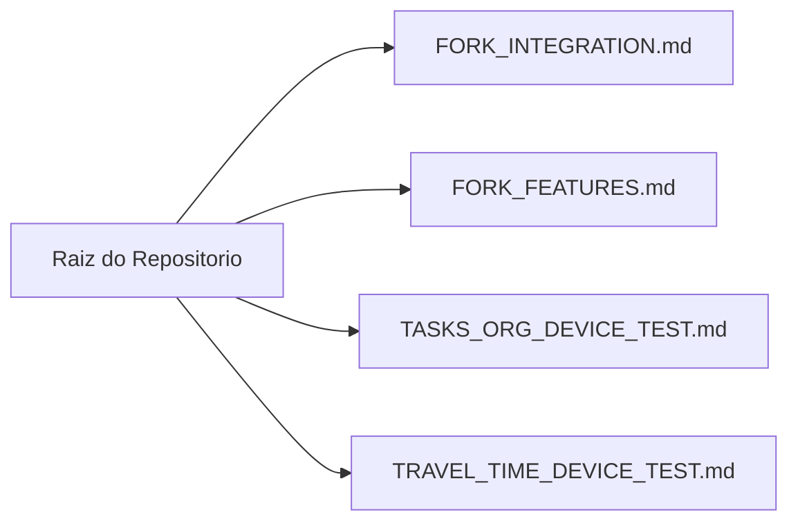
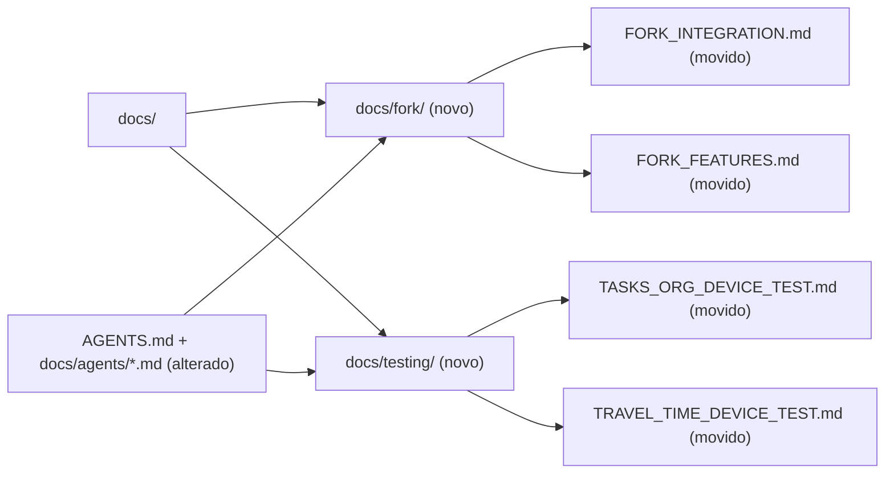

# Design: cleanup-root-docs-post-adopt

## Metadata

- **Complexity Tier**: `light`
- **Architecture References**: `AGENTS.md`, `docs/agents/architecture.md`

## Resumo Técnico (`light` tier)

1. **Onde mexer:** Diretórios de documentação (`docs/fork/`, `docs/testing/`, `AGENTS.md`, `docs/agents/*.md`) e remoção dos 4 arquivos `.md` correspondentes na raiz do repositório (`FORK_INTEGRATION.md`, `FORK_FEATURES.md`, `TASKS_ORG_DEVICE_TEST.md`, `TRAVEL_TIME_DEVICE_TEST.md`).
2. **Padrão a seguir:** Manter na raiz apenas `README.md`, `AGENTS.md` e `CLAUDE.md` (padrão canônico do `/opsh:ai-context`), organizando documentos específicos do fork em `docs/fork/` e roteiros de QA manual em `docs/testing/`.
3. **Como validar:** Verificar via `test ! -f` que os 4 arquivos não existem mais na raiz, `test -f` que existem em `docs/fork/` e `docs/testing/`, e `grep` que todas as referências em `AGENTS.md` e `docs/agents/*.md` apontam para os novos caminhos.

## AS IS — Estado e Componentes Atuais

Os 4 documentos específicos do fork residem na raiz para alimentar a execução inicial do `/opsh:ai-context --adopt`.

## TO BE — Estado e Componentes Propostos

Após o `/opsh:ai-context --adopt`, os documentos são movidos para `docs/fork/` (RF-01) e `docs/testing/` (RF-02), mantendo a raiz limpa.
