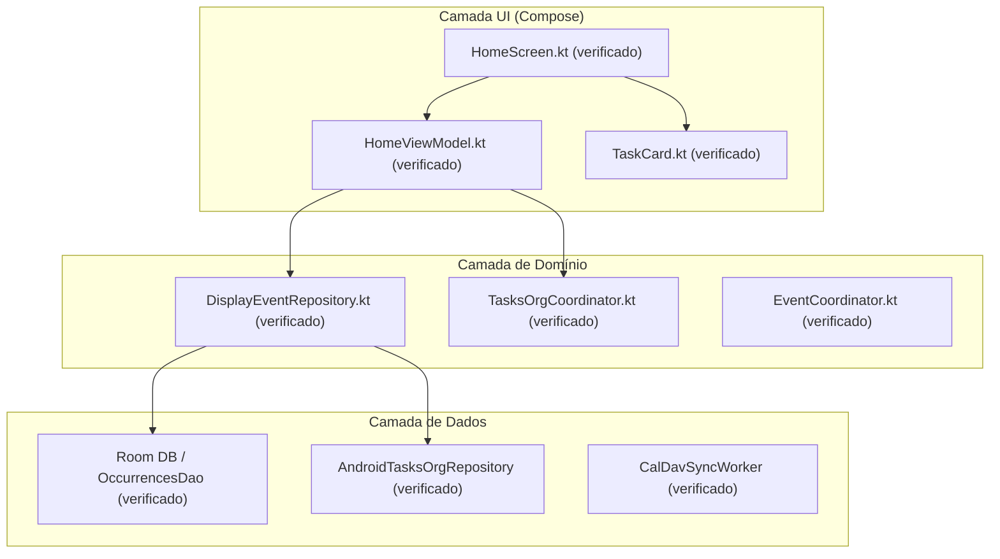
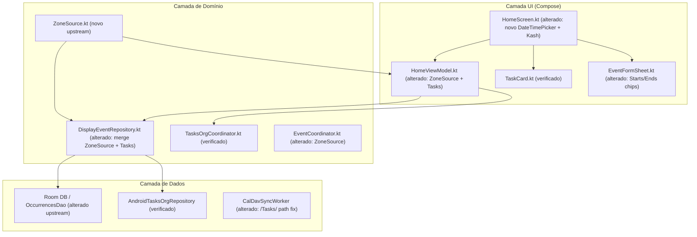

# Design & Technical Plan

## Context & Architecture Grounding
- **Fontes Arquiteturais**: `AGENTS.md`, `docs/agents/architecture.md`, `docs/agents/domain_rules.md`, `docs/fork/FORK_INTEGRATION.md`.
- **Regras de Camadas**: Fluxo unidirecional UI (Compose + ViewModels) → Domínio (`EventCoordinator`, `TasksOrgCoordinator`, `EventReader`) → Dados (Room, CalDAV, DataStore, `AndroidTasksOrgRepository`).
- **Invariante de Isolamento Tasks.org**: Tarefas lidas do Tasks.org via `ContentProvider` (`AndroidTasksOrgRepository`) continuam expostas como `DisplayEvent.Task` em memória. Nenhuma tarefa do Tasks.org é persistida no Room.
- **Invariante de Rebase/Merge**: Toda adição do fork é aditiva e preserva os marcadores `// FORK:tasks-org` e `// FORK:travel-time`.

## Goals / Non-Goals

**Goals:**
- Integrar os 3 commits upstream (`7960b57f`, `fe58d81d`, `9ec14f3b`) no branch `main` do fork sem perder histórico.
- Resolver os conflitos nos 7 arquivos de núcleo seguindo o guia de enxerto em `docs/fork/FORK_INTEGRATION.md`.
- Conectar o novo `ZoneSource` / `LocalDisplayZone` aos fluxos de `DisplayEvent.Task` para que tarefas e alertas de viagem reajam consistentemente a mudanças de fuso horário.
- Harmonizar o novo sistema de backup automático do upstream (para calendários offline) com a estrutura de auto-backup do fork.
- Atualizar as traduções em `values-pt` e `values-pt-rBR`.
- Garantir 100% de aprovação na suíte de testes unitários (`./gradlew testDebugUnitTest`).
- Realizar deploy e teste de fumaça no dispositivo Android físico conectado (`RQ8N502VJ1M`).

**Non-Goals:**
- Reescrever a arquitetura da integração com Tasks.org ou substituir o `TasksOrgV0Mapper`.
- Alterar o comportamento dos provedores de roteamento do Travel Time (TomTom, OSRM, GraphHopper).
- Forçar `git push` ou rebases destrutivos sem aprovação.

## AS IS — Estado e Componentes Atuais

O fork lê eventos do Room e tarefas via `AndroidTasksOrgRepository`, combinando-os em `DisplayEventRepository`. O gerenciamento de fuso no upstream era estático por `ZoneId.systemDefault()`.

## TO BE — Estado e Componentes Propostos

O novo `ZoneSource` propaga reativamente o fuso horário atual para `DisplayEventRepository` e `HomeViewModel` (RF-01, RF-04), enquanto `EventFormSheet` adota o novo seletor unificado de datas (RF-02) e `TaskEditorSheet` permanece como o formulário especializado de tarefas do Tasks.org.

## RIGID vs FLEXIBLE Boundaries
- **RIGID (Invariantes Inegociáveis)**:
  - Nunca persistir tarefas do Tasks.org no Room database (`docs/agents/domain_rules.md`).
  - Gating estrito: desativar "Integração com Tasks.org" deve reverter o app ao comportamento exato do KashCal upstream.
  - Todas as adições do fork no core devem reter comentários `// FORK:tasks-org` ou `// FORK:travel-time`.
  - Nenhuma string voltada ao usuário hardcoded (usar `strings.xml` e sincronizar `values-pt` / `values-pt-rBR`).
- **FLEXIBLE (Autonomia de Implementação)**:
  - Resolução de conflitos linha a linha mantendo os imports e métodos auxiliares de ambos os lados.
  - Adaptação interna de listeners do `ZoneSource` em `DisplayEventRepository`.

## Decisions

1. **Estratégia de Integração (Merge vs Rebase)**:
   - *Decisão*: Executar um `git merge origin/main` (ou cherry-pick controlado das 3 tags/commits). Como o branch `main` do fork já possui commits publicados e um histórico linear detalhado de epics e docs, um merge commit explícito `chore: sync upstream v2026.11.03 into fork` preserva a rastreabilidade completa e respeita o fluxo Git padrão.
2. **Harmonização do `DisplayEventRepository.kt`**:
   - *Decisão*: Upstream mudou a assinatura interna ou o fluxo de observação de ocorrências para receber `zoneId: ZoneId`. No fork, a injeção de tarefas `tasksOrgRepository.getTasksForPeriod(rangeStart, rangeEnd)` receberá os mesmos limites de data derivados do fuso horário ativo, garantindo que tarefas não troquem de dia em transições de fuso.
3. **Resolução de Conflitos em Settings (`SettingsRoute.kt` e `AccountSettingsViewModel.kt`)**:
   - *Decisão*: Preservar as adições do fork (`SettingsDestination.TasksOrg`, telas de listas/tags/lugares) ao lado das novas rotas do upstream (novo fluxo de `ForceFullSyncConfirm` in-place e `OfflineCalendars`).

## Risks / Trade-offs

| Risk | Blast Radius | Mitigation | Rollback |
|---|---|---|---|
| Quebra de compilação por assinatura modificada em `DisplayEventRepository` | Alto (Build falha) | Adaptar chamada de tarefas ao novo fluxo de fuso do repositório | Desfazer merge ou restaurar versão prévia de `DisplayEventRepository.kt` |
| Conflito de chaves em `strings.xml` | Médio (Strings ausentes) | Mesclar chaves e rodar `gen_strings_pt.py` para sincronizar `pt` e `pt-BR` | `git checkout HEAD -- app/src/main/res/values*` |
| Tarefas trocarem de dia com mudança de fuso | Médio (UX de tarefas) | Mapear datas de tarefas preservando `LocalDate` absoluto no fuso ativo | Reverter adaptação de `ZoneSource` para tarefas |

## Open Questions
- Nenhuma dúvida bloqueante; todos os 7 arquivos de conflito e suas responsabilidades foram mapeados no código.
