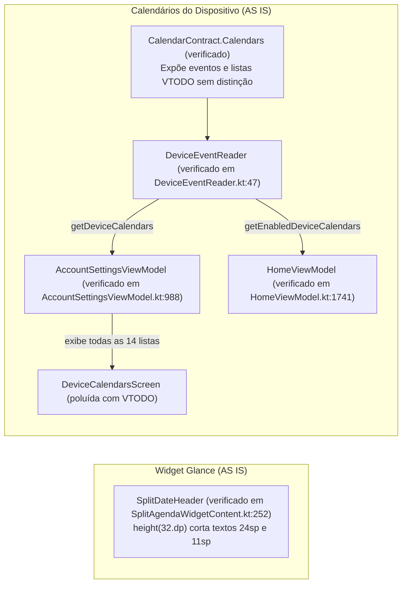
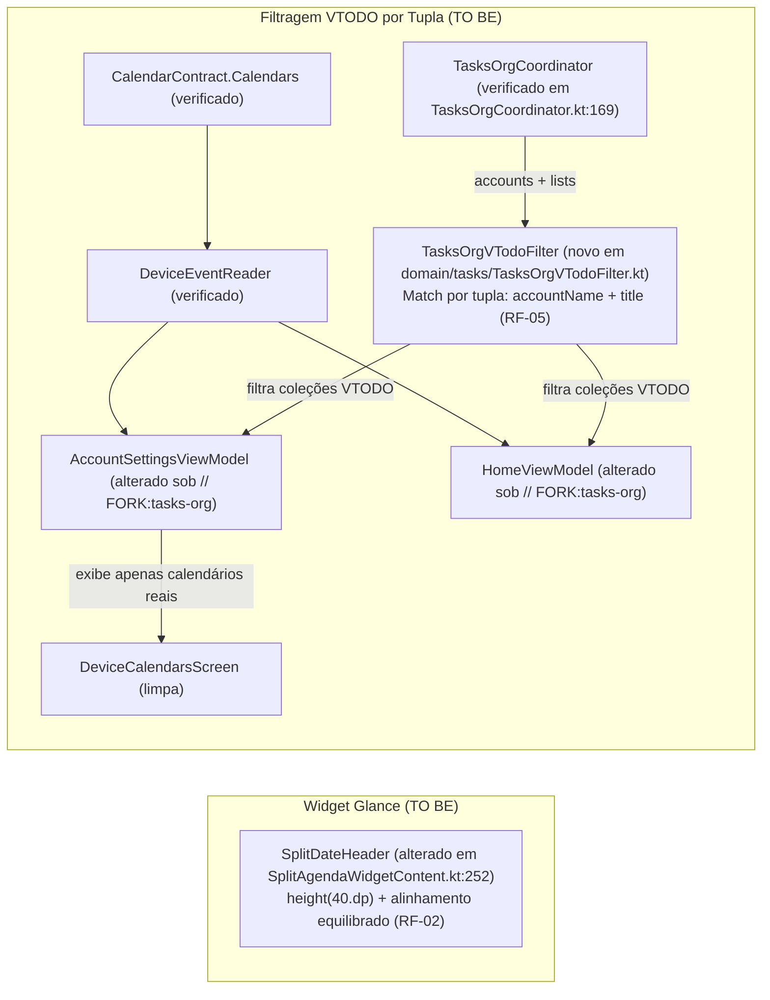

# Design & Technical Plan

## Context & Architecture Grounding

Este design resolve dois refinamentos no fork `kashcal_tasks`:
1. **Correção de layout no widget (`SplitAgendaWidgetContent.kt`)**: Eliminar o truncamento visual vertical do cabeçalho da coluna esquerda no Glance RemoteViews.
2. **Filtragem de listas VTODO nos calendários do dispositivo**: Evitar a poluição da listagem de calendários do dispositivo com coleções de tarefas já gerenciadas pelo Tasks.org.

Conforme as diretrizes arquiteturais de `AGENTS.md` e `docs/agents/domain_rules.md`:
- **Tasks.org Non-Persistence**: Tarefas nunca são gravadas no Room. O KashCal atua como cliente de apresentação via `org.tasks.api`.
- **Fork Gating & Upstream Parity**: Toda nova lógica no core deve ser condicionada ao toggle `dataStore.getTasksOrgEnabled()` e rotulada com `// FORK:tasks-org`. Desativar a integração deve reverter imediatamente a listagem para o comportamento 100% upstream.
- **Unidirectional Flow**: UI (Compose / ViewModels) → Domain (`EventCoordinator`, `TasksOrgCoordinator`) → Data (`CalendarProvider`, `TasksOrgRepository`).

## Goals / Non-Goals

**Goals:**
- Ajustar a altura e o alinhamento de `SplitDateHeader` em `SplitAgendaWidgetContent.kt` para garantir que o número (`24.sp`), dia da semana (`11.sp`) e mês/ano (`11.sp`) renderizem sem cortes no Android físico.
- Criar o componente de domínio `TasksOrgVTodoFilter` para filtrar `DeviceCalendar` cuja tupla `(accountName, displayName)` coincida com uma lista de tarefas da mesma conta no Tasks.org.
- Aplicar a filtragem em `AccountSettingsViewModel.kt` (tela de configurações de calendários) e em `HomeViewModel.kt` (gaveta lateral e picker de calendário padrão) estritamente sob `// FORK:tasks-org`.

**Non-Goals:**
- Sincronizar tarefas diretamente pelo conector CalDAV ou persistir tarefas no Room.
- Alterar o comportamento de exibição quando a integração com Tasks.org estiver desativada.

## AS IS — Estado e Componentes Atuais

_AS IS: `SplitDateHeader` possui altura rígida de 32dp provocando cortes de renderização nativos. As listas VTODO expostas pelo DAVx5 no `CalendarContract` chegam sem filtragem a `AccountSettingsViewModel` e `HomeViewModel`._

## TO BE — Estado e Componentes Propostos

_TO BE: `SplitDateHeader` expande sua restrição para 40dp (RF-02). O novo `TasksOrgVTodoFilter` resolve as tuplas `(account, list)` e omite coleções de tarefas do Tasks.org das superfícies de calendários do dispositivo (RF-05)._

## RIGID vs FLEXIBLE Boundaries

- **RIGID (Non-Negotiable)**:
  - O filtro deve usar a tupla composta normalizada `(accountName.trim().lowercase(), displayName.trim().lowercase())`. Jamais filtrar apenas pelo nome global da lista para evitar falsos positivos em outras contas.
  - Toda e qualquer adição aos arquivos do core (`AccountSettingsViewModel.kt`, `HomeViewModel.kt`, etc.) deve conter a sentinela `// FORK:tasks-org`.
  - Se `tasksOrgEnabled == false`, nenhuma filtragem é aplicada, mantendo paridade funcional e visual idêntica ao upstream.
  - O grid mensal de 6 semanas no `SplitAgendaWidget` não pode ser quebrado nem ultrapassar os limites do widget.

## Decisions

1. **Tupla `(accountName, title)` vs Apenas `title`**:
   - *Decisão*: Filtrar exclusivamente quando a conta do `DeviceCalendar` coincidir com a conta do Tasks.org e o nome do calendário coincidir com o título da lista.
   - *Motivo*: Evita que um calendário de eventos legítimo do Google ou Exchange chamado "Compras" seja ocultado por uma lista de tarefas homônima em outra conta.
2. **Criação do helper puro `TasksOrgVTodoFilter`**:
   - *Decisão*: Isolar a lógica de cruzamento de tuplas e filtragem em um `object TasksOrgVTodoFilter` testável com JUnit puro em `org.onekash.kashcal.domain.tasks`.
   - *Motivo*: Mantém os toques nos ViewModels mínimos (poucas linhas de enxerto marcadas com `// FORK:tasks-org`) e facilita a cobertura de testes unitários.
3. **Altura de 40dp no cabeçalho do widget**:
   - *Decisão*: Fixar a altura do `SplitDateHeader` em `40.dp` e ajustar os espaçadores adjacentes para 2dp.
   - *Motivo*: Acomoda com folga os 24sp do número (~32dp line-height) e as duas linhas de 11sp da coluna lateral, sem consumir espaço excessivo do grid de 6 semanas.

## Risks / Trade-offs

| Risk | Blast Radius | Mitigation | Rollback |
|---|---|---|---|
| Lista de tarefas renomeada no Tasks.org mas ainda com nome antigo no CalDAV | A lista pode reaparecer temporariamente nos calendários do dispositivo | O `ContentObserver` do Tasks.org dispara releitura das listas | Desativar integração Tasks.org reverte ao upstream |
| Grid do mês ficar comprimido em telas muito curtas | Estética da coluna esquerda no widget | Testes unitários com `DpSize` e calibração fina dos `Spacer`s de 2dp | Restaurar altura anterior |

## Open Questions
Nenhuma ambiguidade bloqueante. Critérios de aceite e estratégia de filtro acordados com o desenvolvedor.
