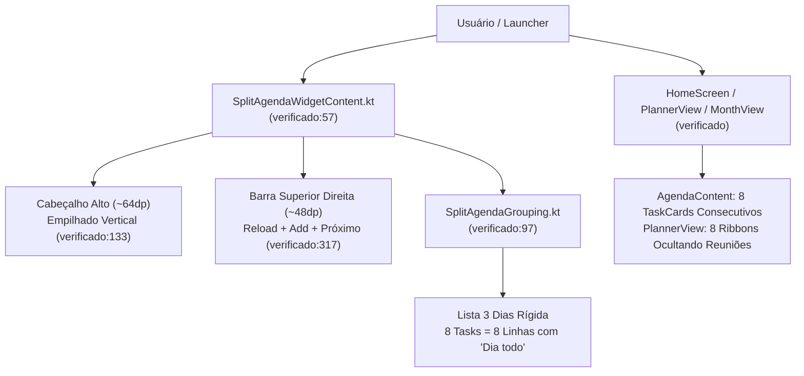
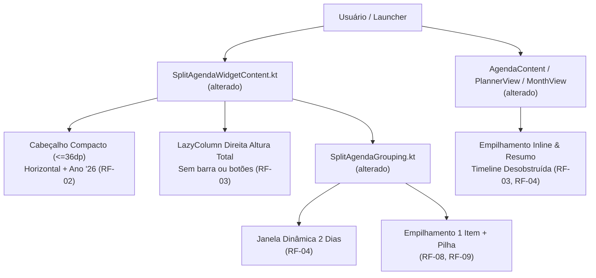

# Design & Technical Plan

## Context & Architecture Grounding
Esta mudança refina a ergonomia do `SplitAgendaWidget` e implementa o empilhamento de itens de dia todo tanto no widget quanto nas visões do aplicativo (`AgendaContent`, `PlannerView` e `MonthView`), conforme especificado em `proposal.md` e nos deltas `fork-widgets` e `tasks-org-integration`.
Diretrizes e fontes de arquitetura consultadas:
- `AGENTS.md`: Unidirectional Flow (UI → Domain → Data); regras de não-persistência do Tasks.org (`DisplayEvent.Task` via `ContentProvider`).
- `docs/agents/architecture.md`: Separação estrita entre os dados do Room e do Tasks.org; widgets atualizados reativamente via `WidgetUpdateManager`.
- `docs/agents/domain_rules.md`: Invariantes de tarefas do Tasks.org e renderização em Glance/RemoteViews.

## Goals / Non-Goals

**Goals:**
- Eliminar a barra de cabeçalho da coluna direita do `SplitAgendaWidget` (`WidgetRefreshButton`, `WidgetAddButton` e "Próximo"), aproveitando 100% da altura para a agenda.
- Compactar o cabeçalho de data da coluna esquerda (altura <= 36dp) usando layout horizontal com ano abreviado (`Nov '26`), liberando +32dp de altura para a grade mensal.
- Implementar janela dinâmica de 2 dias (Hoje/Amanhã ou Amanhã/Depois de amanhã).
- Implementar a regra de "1 Item de Dia Todo + Pilha" no widget e suprimir o texto "Dia todo" em tarefas.
- Estabelecer navegação por convenção: toques em tarefas/pilhas, eventos e coluna esquerda abrem o KashCal (preservando o atalho do Tasks.org no QuickView).
- Empilhar tarefas de dia todo nas telas de Agenda, Planejador e Mês do app para proteger a visualização da timeline cronológica.

**Non-Goals:**
- Não criar telas ou switches de configuração para o destino dos cliques (adotado Convention over Configuration).
- Não alterar as views de Dia, 3 Dias e Semana (já isoladas pelo `AllDayStripLayout`).
- Não persistir itens do Tasks.org no Room.

## AS IS — Estado e Componentes Atuais

*Legenda: O estado atual sofre com sobrecarga de cabeçalhos no widget, ausência de empilhamento de itens de dia todo e poluição com o texto "Dia todo", resultando em ocultação de compromissos com horário.*

## TO BE — Estado e Componentes Propostos

*Legenda: A arquitetura proposta compacta a data (RF-02), elimina a barra de botões da direita (RF-03), dinamiza a janela para 2 dias (RF-04), introduz o motor de empilhamento de dia todo (RF-08, RF-09) e protege a timeline nas visões do app (RF-03, RF-04).*

## RIGID vs FLEXIBLE Boundaries

### RIGID (Non-Negotiable)
- **Não-persistência do Tasks.org**: Tarefas continuam sendo lidas via `ContentProvider` e renderizadas como `DisplayEvent.Task`.
- **Acessibilidade e Usabilidade Glance**: Ações interativas em Glance devem manter touch targets adequados e nunca quebrar em RemoteViews.
- **Convenção de Cliques**:
  - Coluna esquerda e eventos abrem o KashCal.
  - Pilha de tarefas abre o KashCal (onde o contexto do dia está reunido).
  - Checkbox da tarefa completa inline via `ToggleTaskAction`.
- **Supressão de "Dia todo"**: Tarefas nunca devem exibir o texto "Dia todo" no widget.

### FLEXIBLE (Implementation Autonomy)
- Estilo exato dos badges/pills expansíveis na Agenda do app (animação via Compose `AnimatedVisibility` ou `animateItem`).
- Estrutura interna de data classes em `SplitAgendaGrouping.kt` (`SplitAgendaItem.AllDayEventStack`, `SplitAgendaItem.AllDayTaskStack`).
- Formatação precisa da string do ano abreviado no helper de data (`'yy`).

## Decisions

### 1. Eliminação total da barra superior da coluna direita do widget
- **Opção A**: Manter o botão `+` alinhado à direita e remover apenas `↻` e "Próximo".
- **Opção B (Escolhida)**: Remover a barra inteira de ferramentas.
- **Justificativa**: A remoção da linha completa libera **48dp inteiros** de altura vertical. O usuário já pode criar eventos tocando no calendário ou usando os atalhos do app no launcher. O ganho de espaço para visualizar compromissos supera largamente o atalho redundante.

### 2. Disposição horizontal compacta da data na coluna esquerda
- **Opção A**: Reduzir apenas o tamanho da fonte do cabeçalho vertical.
- **Opção B (Escolhida)**: Número do dia grande em bloco à esquerda (`5`), dia da semana e mês com ano abreviado empilhados à direita (`QUA \n Nov '26`).
- **Justificativa**: Reduz a altura do cabeçalho de ~64dp para ~32dp, conferindo mais de 30dp de folga vertical para a grade do mês de 6 semanas, resolvendo o problema de células achatadas.

### 3. Janela dinâmica de 2 dias
- **Opção A**: Manter 3 dias fixos.
- **Opção B (Escolhida)**: Hoje + Amanhã se há itens futuros hoje; caso contrário, Amanhã + Depois de amanhã.
- **Justificativa**: Evita gastar espaço com estados vazios inúteis no final do dia ("Nenhum evento hoje"), exibindo os próximos 2 dias relevantes de forma dinâmica.

### 4. Empilhamento "1 Item + Pilha" e Separação Semântica
- **Opção A**: Juntar eventos e tarefas na mesma pilha.
- **Opção B (Escolhida)**: Pilhas separadas para eventos de dia todo (`📅 +X eventos`) e tarefas de dia todo (`✓ +X tarefas`).
- **Justificativa**: Eventos de dia todo são contextuais/passivos (feriados, aniversários), enquanto tarefas são ativas/marcáveis (contas, to-dos). Manter a 1ª tarefa com checkbox marcável inline permite ação rápida sem abrir o app.

## Risks / Trade-offs

| Risk | Blast Radius | Mitigation | Rollback |
|---|---|---|---|
| **Quebra de layout em telas muito estreitas (< 260dp)** | SplitAgendaWidget (Modo Compacto) | `CompactSplitLayout` já trata larguras reduzidas herdando o empilhamento | Reverter para layout original de coluna única |
| **Overflow de RemoteViews no Glance com muitas tasks** | Widget | O empilhamento "1 Item + Pilha" reduz drasticamente o número de nós RemoteViews, protegendo contra o limite de 1MB do Binder | N/A (o empilhamento diminui o risco de Binder overflow) |
| **Inconsistência de strings de data entre idiomas** | Textos do widget | Usar `DateTimeUtils.localizedPattern` e ferramentas de geração de strings em `values`, `values-pt`, `values-pt-rBR` | Checagem em testes unitários |

## Open Questions
- Nenhuma questão bloqueante pendente. Todos os pontos foram validados no explore mode.
