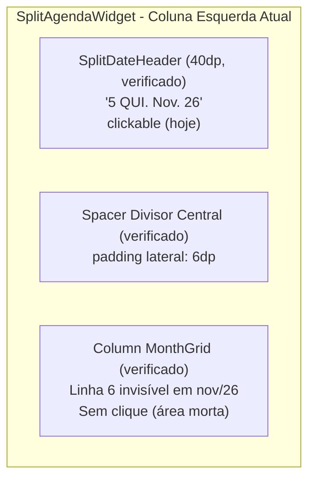
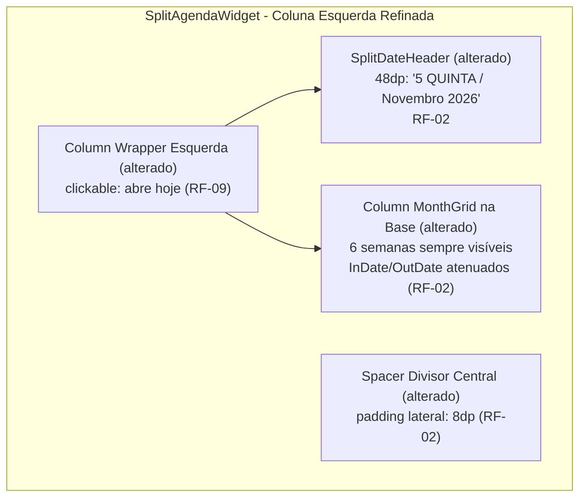

# Design & Technical Plan

## Context & Architecture Grounding
- **Referências Arquiteturais**: `AGENTS.md`, `docs/agents/architecture.md`, `docs/agents/coding_guidelines.md`.
- **Camada**: UI / Android Glance AppWidgets (`SplitAgendaWidgetContent.kt`).
- O widget divide-se em duas colunas no modo amplo (`isWide >= 260.dp`). Este design atua exclusivamente no equilíbrio visual, proporção, preenchimento e interatividade da coluna esquerda e da linha divisória central, sem tocar no fluxo de sincronização ou na coluna da agenda.

## Goals / Non-Goals

**Goals:**
- Prover um cabeçalho de data imponente no topo da coluna esquerda com altura de ~48dp a 50dp, número em destaque e textos por extenso (`QUINTA`, `Novembro 2026`).
- Renderizar invariavelmente 6 semanas completas na grade mensal ancorada na base da coluna esquerda, exibindo dias adjacentes (`InDate` e `OutDate`) em cinza atenuado (`WidgetTheme.adjacentMonthText`).
- Harmonizar o padding lateral da divisória central em 8dp de cada lado, alinhando com a margem interna do container.
- Envolver a coluna esquerda em um wrapper de clique único disparando `ACTION_GO_TO_TODAY` para o KashCal.

**Non-Goals:**
- Alterações no comportamento da coluna direita (regras de empilhamento e dinâmica de próximos eventos permanecem intactas).
- Cliques individuais por célula da grade (evitando estouro de View-IDs do Glance).
- Alterações em Room ou camadas de domínio.

## AS IS — Estado e Componentes Atuais

_AS-IS: Cabeçalho com 40dp e textos abreviados comprimidos à esquerda; grade de semanas oculta dias fora do mês deixando a 6ª linha invisível; apenas o cabeçalho responde ao clique._

## TO BE — Estado e Componentes Propostos

_TO-BE: A coluna esquerda inteira torna-se clicável (RF-09) abrindo o KashCal em hoje; o cabeçalho ganha altura (~48dp–50dp) e textos completos (RF-02); a grade tem 6 semanas completas com dias adjacentes atenuados ancorada na base (RF-02); e a divisória central recebe padding lateral de 8dp (RF-02)._

## RIGID Boundaries
- **RIGID (Invariantes Técnicos)**:
  - A grade mensal deve sempre iterar pelas 6 semanas de `data.monthGrid.weeks`.
  - Células com `position != MonthDate` (`InDate` e `OutDate`) devem exibir o número com a cor `WidgetTheme.adjacentMonthText()` e NUNCA exibir indicador de evento (`hasEvents`).
  - O container pai da coluna esquerda inteira deve possuir o modificador `.clickable(actionStartActivity<MainActivity>(...ACTION_GO_TO_TODAY))`.
  - A divisória central deve ter padding lateral de 8dp (`padding(start = 8.dp, end = 8.dp)` ou equivalente nos containers adjacentes).

## Decisions

1. **Textos por extenso no cabeçalho**:
   - `today.dayOfWeek.getDisplayName(TextStyle.FULL, locale).uppercase()` fornece "QUINTA" (ou "QUINTA-FEIRA" dependendo do tratamento de hífen). Para máxima clareza em PT-BR, usar o nome do dia em caixa alta (ex: `QUINTA` ou `QUINTA-FEIRA`) e o mês completo com ano (`Novembro 2026`).
   - Razoabilidade: Ocupa harmonicamente os ~160dp da coluna esquerda sem corte.

2. **6 Semanas com dias adjacentes atenuados**:
   - Em vez de renderizar `Box` vazio quando `position != MonthDate`, renderiza o número do dia com `WidgetTheme.adjacentMonthText()`.
   - Razoabilidade: Garante estabilidade geométrica em todos os meses do ano (evitando a sensação de buraco em meses como novembro e acomodando meses como agosto).

3. **Wrapper de clique único na coluna inteira**:
   - Aplicar `.clickable(...)` na `Column` raiz da coluna esquerda.
   - Razoabilidade: Proporciona uma área de toque ampla de 50% do widget e consome apenas 3 View-IDs no Glance, contra mais de 120 View-IDs se cada dia fosse clicável.

## Risks / Trade-offs

| Risk | Blast Radius | Mitigation | Rollback |
|---|---|---|---|
| Altura do cabeçalho comprimir a grade em widgets muito baixos (< 180dp) | Coluna esquerda | Altura calibrada em ~48dp–50dp com semanas em `defaultWeight()`, mantendo proporção estável | Reverter para 40dp |
| Estouro de caracteres em idiomas com nomes de meses longos | Header da data | Usar `maxLines = 1` e fontes ajustadas (12sp/13sp) | N/A |

## Open Questions
- _Nenhuma questão aberta bloqueante; decisões consolidadas na sessão de exploração._
