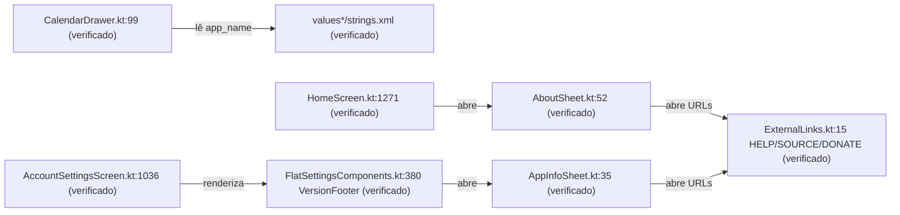
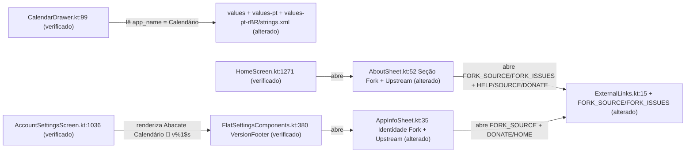

# Design & Technical Plan

## Context & Architecture Grounding

Esta mudança consolida a identidade visual interna do **Abacate Calendário** no módulo `:app` sem alterar pacotes, banco de dados ou contratos de sincronização. Conforme estabelecido em `AGENTS.md`, `docs/agents/architecture.md`, `docs/agents/coding_guidelines.md` e `docs/agents/domain_rules.md`:
- **Disciplina de Strings e Localização (`coding_guidelines.md` §5)**: Nunca codificar strings visíveis ao usuário diretamente em Kotlin/Compose; declarar recursos em `app/src/main/res/values/strings.xml` e atualizar simultaneamente `values-pt/strings.xml` e `values-pt-rBR/strings.xml` (sem editar manualmente outros diretórios `values-*`).
- **Isolamento de Pontos de Enxertia (`coding_guidelines.md` §3)**: Alterações em arquivos core do upstream (`AboutSheet.kt`, `AppInfoSheet.kt`, `ExternalLinks.kt`) devem ser documentadas em `docs/fork/FORK_INTEGRATION.md`.
- **Acessibilidade e Testes Determinísticos (`coding_guidelines.md` §5, §7)**: Elementos clicáveis em `AboutSheet` e `AppInfoSheet` devem preservar `Role.Button` e `contentDescription` para TalkBack, passando nos testes Robolectric sob `-Duser.language=en -Duser.country=US`.

## Goals / Non-Goals

**Goals:**
- Exibir `"Calendário"` no topo de `CalendarDrawer.kt` (via `R.string.app_name`) e `"Abacate Calendário"` em todas as strings conversacionais do sistema.
- Estruturar `AboutSheet.kt` e `AppInfoSheet.kt` com destaque primário para `"Abacate Calendário 🥑"` e links do fork (`FORK_SOURCE`, `FORK_ISSUES`), preservando logo abaixo os créditos e links originais do upstream KashCal (`HELP`, `SOURCE`, `DONATE`, `HOME`).
- Exibir `"Abacate Calendário 🥑 v%1$s"` no `VersionFooter` das configurações (`R.string.status_version`).

**Non-Goals:**
- Renomear pacotes Kotlin (`org.onekash.kashcal`), `applicationId` ou esquemas Room.
- Alterar diretórios de idiomas além de `values`, `values-pt` e `values-pt-rBR`.

## AS IS — Estado e Componentes Atuais

Atualmente, `CalendarDrawer.kt`, `AboutSheet.kt`, `VersionFooter` e ~20 strings conversacionais em `values*/strings.xml` exibem `"KashCal"`, enquanto `AboutSheet.kt` e `AppInfoSheet.kt` apontam exclusivamente para URLs do upstream em `ExternalLinks.kt`.

## TO BE — Estado e Componentes Propostos

Na arquitetura proposta, `values/strings.xml`, `values-pt/strings.xml` e `values-pt-rBR/strings.xml` definem `app_name = "Calendário"` e usam `"Abacate Calendário"` nas strings conversacionais (`RF-06`), enquanto `AboutSheet.kt` (`RF-07`) e `VersionFooter`/`AppInfoSheet.kt` (`RF-08`) apresentam `"Abacate Calendário 🥑"` e os links do fork (`ExternalLinks.FORK_SOURCE`, `ExternalLinks.FORK_ISSUES`) acima da seção de créditos e suporte ao upstream KashCal.

## RIGID Boundaries
- **RIGID (Non-Negotiable)**:
  - Atualizar exclusivamente `values/strings.xml`, `values-pt/strings.xml` e `values-pt-rBR/strings.xml`; jamais editar outros diretórios `values-*`.
  - Preservar todos os links de documentação e apoio ao projeto original (`ExternalLinks.HELP`, `ExternalLinks.SOURCE`, `ExternalLinks.DONATE`, `ExternalLinks.HOME`) nas seções de créditos upstream de `AboutSheet` e `AppInfoSheet`.
  - Manter semântica de acessibilidade (`heading()`, `Role.Button`, `contentDescription` com sufixo de abertura no navegador e `LiveRegionMode.Polite` para falha de link) em `AboutSheet.kt`.

## Decisions
1. **`R.string.app_name` como `"Calendário"` e strings específicas para `"Abacate Calendário 🥑"`**:
   - *Racional*: `CalendarDrawer.kt:99`, `AppLockVeil.kt:96` e `PrintWeekViewModel.kt:268` já consomem `R.string.app_name`. Definir `app_name` como `"Calendário"` atende imediatamente ao requisito minimalista no topo do menu hambúrguer e mantém paridade com `fork_app_name` no launcher, enquanto `AboutSheet` e `AppInfoSheet` usam recursos dedicados (`about_app_title` / `status_version`) com `"Abacate Calendário 🥑"`.
2. **Duas seções em `AboutSheet.kt` reutilizando `RisingRows`**:
   - *Racional*: Mantém o padrão visual e de acessibilidade do componente original (cada linha com ícone, título, subtítulo e `contentDescription` unificado para TalkBack), adicionando cabeçalhos de seção para separar claramente o projeto atual do upstream KashCal.

## Risks / Trade-offs
| Risk | Blast Radius | Mitigation | Rollback |
|---|---|---|---|
| Quebra de asserções em `AboutSheetTest.kt` que verificam textos fixos em inglês (`"KashCal"`, 3 linhas de links) | Testes unitários Robolectric de UI | Atualizar `AboutSheetTest.kt` para validar o novo cabeçalho `"Abacate Calendário 🥑"`, as linhas do fork + upstream e a versão `"Abacate Calendário 🥑 v..."` | `git checkout` nos arquivos de UI/strings |
| Divergência de chaves entre `values/strings.xml` e `values-pt*` causando falha no Android Lint (`MissingTranslation` / `ExtraTranslation`) | Build/Lint do módulo `:app` | Declarar todas as novas chaves simultaneamente em `values`, `values-pt` e `values-pt-rBR` e validar com `./gradlew lintDebug` | Reverter chaves faltantes ou sincronizar via script |

## Open Questions
Nenhuma questão em aberto. Todas as decisões de nomenclatura e layout foram confirmadas na exploração.
