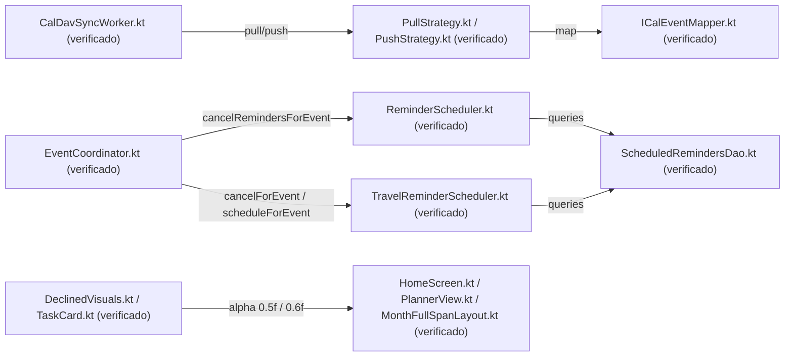
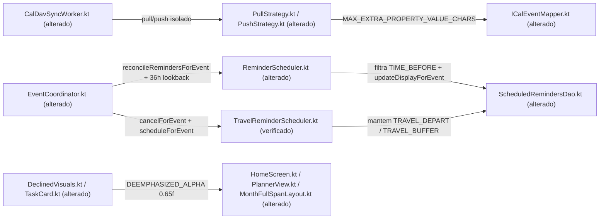

# Design & Technical Plan

## Context & Architecture Grounding
Esta mudança incorpora o commit `f1391fca` (`v2026.11.04`) do repositório upstream `KashCal/KashCal` na base atual do fork (`v2026.11.06`), respeitando rigorosamente a arquitetura e as regras documentadas em:
- `AGENTS.md`: separação estrita UI → Domain → Data, proibição de acesso direto a DAOs em ViewModels, manutenção das sentinelas `// FORK:tasks-org`, `// FORK:travel-time` e `// FORK:fork-identity`, e atualização conjunta de `values/strings.xml`, `values-pt/strings.xml` e `values-pt-rBR/strings.xml`.
- `docs/agents/architecture.md`: isolamento das camadas `sync/strategy/`, `reminder/scheduler/`, `reminder/travel/` e `ui/`.
- `docs/agents/domain_rules.md`: ciclo de vida de `PendingOperation`, modelo mestre/exceção RFC 5545 e coexistência dos lembretes `TIME_BEFORE` com `TRAVEL_DEPART`/`TRAVEL_BUFFER` na tabela `scheduled_reminders`.

## Goals / Non-Goals

**Goals:**
- Integrar 100% das melhorias de sync (`ICalEventMapper`, `PullStrategy`, `PushStrategy`), lembretes (`ReminderScheduler.reconcileRemindersForEvent`, `STARTED_LOOKBACK_MS = 36h`), contraste (`DEEMPHASIZED_ALPHA = 0.65f`) e ícones (`AppIconPreset.KASH` e rótulo `@string/app_icon_label_calendar` nos dias 1..31) da versão `v2026.11.04`.
- Garantir que `ReminderScheduler.reconcileRemindersForEvent` coexista sem conflito com as linhas `TRAVEL_DEPART` e `TRAVEL_BUFFER` gerenciadas pelo `TravelReminderScheduler`.
- Alinhar a opacidade de tarefas concluídas no `TaskCard` à nova constante `DEEMPHASIZED_ALPHA = 0.65f`.
- Preservar a identidade do fork (`R.string.fork_app_name` no manifesto/testes, `version.properties` em `821`/`2026.11.06`, ausência de `fastlane/metadata/android/`).

**Non-Goals:**
- Alterar o esquema do banco de dados Room (permanece na versão 28).
- Modificar a lógica de cálculo de rotas do `TravelAlarmWorker` ou o contrato de `ContentProvider` do Tasks.org.

## AS IS — Estado e Componentes Atuais

No estado atual (`v2026.11.06` antes do merge da `v2026.11.04`), edições de eventos cancelam todos os lembretes via `cancelRemindersForEvent` (perdendo o estado `SNOOZED` e notificações `FIRED`), ocorrências iniciadas à meia-noite UTC do dia corrente não entram na janela de agendamento após as 00:00 UTC, propriedades extras gigantes no `ICalEventMapper` podem exceder o `CursorWindow` de 2 MB do SQLite, e itens de-enfatizados usam opacidades `0.5f` e `0.6f`.

## TO BE — Estado e Componentes Propostos

No estado proposto, `PullStrategy`, `PushStrategy` e `ICalEventMapper` implementam o isolamento de falhas e proteção de 2 MB (`RF-06`), `ReminderScheduler` reconcilia lembretes `TIME_BEFORE` in-place com lookback de 36h sem apagar lembretes de viagem (`RF-07`), `DeclinedVisuals` e `TaskCard` unificam a opacidade em `DEEMPHASIZED_ALPHA = 0.65f` (`RF-08`), e `AppIconPreset` / `AndroidManifest.xml` adicionam o ícone `Kash` e os rótulos dos dias 1..31 preservando `fork_app_name` (`RF-09`).

## RIGID vs FLEXIBLE Boundaries
- **RIGID (Non-Negotiable)**:
  - `ReminderScheduler.reconcileRemindersForEvent` DEVE ignorar linhas com `row.reminderType != ReminderType.TIME_BEFORE` ao verificar/remover offsets RFC 5545, para que `TRAVEL_DEPART` e `TRAVEL_BUFFER` não sejam excluídos durante sincronizações CalDAV.
  - `EventCoordinator.rescheduleRemindersForEvent` DEVE continuar invocando `travelReminderScheduler?.cancelForEvent(event.id)` antes de `scheduleRemindersForEvent(event)` para recalcular rotas se o horário ou local do evento mudar localmente.
  - `LauncherAliasManifestTest` DEVE validar os aliases padrão contra `R.string.fork_app_name` (`"Calendário"`) e os aliases de dia/supporter-calendar contra `R.string.app_icon_label_calendar`.
  - O arquivo `fastlane/metadata/android/en-US/changelogs/820.txt` NÃO DEVE existir na árvore final do repositório (`fork-identity-distribution` RF-03).
- **FLEXIBLE (Implementation Autonomy)**:
  - Ordem interna de métodos auxiliares em `ScheduledRemindersDao.kt` e `ReminderScheduler.kt`, desde que mantenham os comentários `// FORK:travel-time` nos pontos de enxerto.

## Decisions
1. **Filtro `row.reminderType != ReminderType.TIME_BEFORE` em `ReminderScheduler.reconcileRemindersForEvent`**:
   - *Por quê*: O `ReminderScheduler` do upstream assume que todas as linhas de `scheduled_reminders` possuem um `reminderOffset` RFC 5545 (`-PT15M`, `-P1D`). No fork, o `TravelAlarmWorker` grava linhas com `reminderOffset = "TRAVEL_DEPART"` e `"TRAVEL_BUFFER"` e `reminderType != ReminderType.TIME_BEFORE`. Pular essas linhas no loop de reconciliação de offsets do `ReminderScheduler` (enquanto `updateDisplayForEvent` no final ainda atualiza título/local/cor de todas as linhas do evento) garante coexistência perfeita tanto em syncs remotos quanto em edições locais.
2. **Alinhamento de `TaskCard.kt` com `DEEMPHASIZED_ALPHA = 0.65f`**:
   - *Por quê*: Mantém consistência visual e de contraste WCAG AA entre eventos passados/recusados e tarefas concluídas em todas as visões do calendário.
3. **Incorporação de `AppIconPreset.KASH` e rótulos de `MainActivityDay1..31` com ajuste em `LauncherAliasManifestTest`**:
   - *Por quê*: Preserva compatibilidade total com os testes de ícones do upstream (`AppIconPresetTest`, `AppIconUtilityTest`, `DayIconsTest`) enquanto respeita `fork_app_name` (`"Calendário"`) como rótulo principal do aplicativo.

## Risks / Trade-offs
| Risk | Blast Radius | Mitigation | Rollback |
|---|---|---|---|
| Reconciliação de lembretes apagar alarmes de viagem (`TRAVEL_DEPART`) durante sync CalDAV | Notificações de tempo de viagem de eventos sincronizados | Guardar `if (row.reminderType != ReminderType.TIME_BEFORE) continue` em `reconcileRemindersForEvent` e cobrir com teste unitário | Reverter alteração em `ReminderScheduler.kt` |
| Conflito de rótulo de aplicativo no `LauncherAliasManifestTest` (`app_name` vs `fork_app_name`) | Falha em `LauncherAliasManifestTest` | Usar `context.getString(R.string.fork_app_name)` para aliases não-calendário em `LauncherAliasManifestTest` | Ajustar asserção no teste |
| Reintrodução acidental de arquivos `fastlane/` no merge do commit `f1391fca` | Violação da spec `fork-identity-distribution` RF-03 | Remover `fastlane/metadata/android/en-US/changelogs/820.txt` imediatamente após aplicar as mudanças | `git rm -rf fastlane/` |

## Open Questions
Nenhuma questão aberta pendente. Todas as decisões de escopo foram confirmadas durante a exploração.
