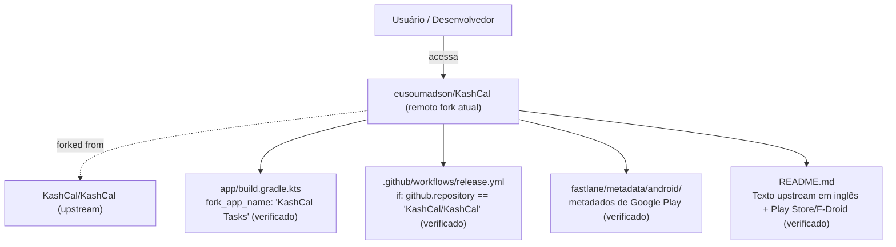
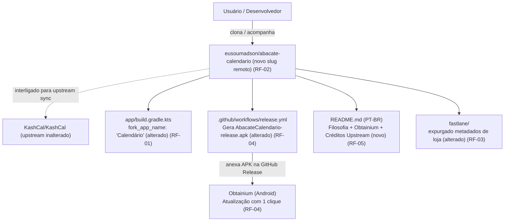

# Design & Technical Plan

## Context & Architecture Grounding
A proposta consolida o aplicativo como **Abacate Calendário** (ecossistema *abacatelab*), com o rótulo visível **"Calendário"** no sistema operacional Android. A arquitetura segue estritamente as diretrizes de [AGENTS.md](file:///Users/madsonsantana/Projetos/kashcal_tasks/AGENTS.md), [docs/agents/architecture.md](file:///Users/madsonsantana/Projetos/kashcal_tasks/docs/agents/architecture.md) e [docs/fork/FORK_INTEGRATION.md](file:///Users/madsonsantana/Projetos/kashcal_tasks/docs/fork/FORK_INTEGRATION.md):
- **Isolamento de Namespace vs Application ID**: O `namespace` permanece `org.onekash.kashcal` para que todos os pacotes Kotlin e referências de classe permaneçam 100% alinhados com o upstream KashCal. O `applicationIdSuffix = ".tasks"` em `app/build.gradle.kts` é mantido para garantir coexistência lado a lado no mesmo dispositivo Android sem conflitos de `AccountAuthenticator`.
- **Integridade dos Graft Points**: Todas as adições do fork permanecem protegidas pelos marcadores `// FORK:tasks-org` e `// FORK:travel-time`. Nenhuma alteração substitutiva é introduzida em arquivos centrais do core.
- **Canal Único de Distribuição**: Transição de metadados de lojas comerciais (Play Store/F-Droid) para canal direto de software livre (APK assinado em GitHub Releases + leitor Obtainium).

## Goals / Non-Goals

**Goals:**
- Renomear o repositório remoto no GitHub para `eusoumadson/abacate-calendario` e sincronizar o remote local `fork`.
- Atualizar `fork_app_name` para `"Calendário"` em `app/build.gradle.kts` e alinhar strings auxiliares.
- Remover referências de lojas proprietárias, o diretório de metadados de loja `fastlane/metadata/android/` e a impressão digital da chave de terceiros.
- Adaptar `.github/workflows/release.yml` para compilar APK assinado do fork sob a convenção `AbacateCalendario-<versao>-release.apk` para consumo pelo Obtainium.
- Criar o `README.md` primário em Português do Brasil com badges de Obtainium/Releases, apresentação do app, guia de instalação e créditos abertos ao upstream.

**Non-Goals:**
- Alterar schemas do banco de dados Room ou a lógica das features existentes (Tasks.org, Travel Time, Widgets).
- Renomear o namespace Kotlin interno dos arquivos fonte (`org.onekash.kashcal`).
- Publicar em lojas corporativas (Google Play Store ou F-Droid oficial).

## AS IS — Estado e Componentes Atuais

*Estado atual do repositório: o código possui as funcionalidades do fork, mas a vitrine (`README.md`), o workflow de CI (`release.yml`), a pasta `fastlane/` e o nome do repositório remoto ainda estão amarrados à identidade e às lojas do KashCal upstream.*

## TO BE — Estado e Componentes Propostos

*Estado proposto: repositório consolidado como `abacate-calendario`, com rótulo "Calendário", pipeline de release gerando APK para o Obtainium, documentação primária em PT-BR e vínculo contínuo com o upstream preservado via git remotes e graft points.*

## RIGID vs FLEXIBLE Boundaries
- **RIGID (Não negociável)**:
  - O `namespace` em `app/build.gradle.kts` deve continuar sendo `org.onekash.kashcal` para não divergir da base upstream nem quebrar imports.
  - O `applicationIdSuffix = ".tasks"` deve ser preservado para manter o aplicativo instalável lado a lado com o KashCal original sem colisão de contas no Android.
  - Os marcadores de sentinela `// FORK:tasks-org` e `// FORK:travel-time` devem ser rigorosamente mantidos.
  - Todos os testes unitários (`./gradlew testDebugUnitTest`) devem continuar passando 100%.
- **FLEXIBLE (Autonomia de implementação)**:
  - Formatação exata de tópicos e títulos do `README.md`.
  - Reorganização de imagens e screenshots necessárias para a vitrine sob `images/` ou `docs/images/`.

## Decisions

### D-01: Rótulo de Lançador "Calendário" vs Marca "Abacate Calendário"
- **Decisão**: Utilizar `"Calendário"` em `fork_app_name` (o que aparece no ícone da tela inicial do celular) e identificar formalmente o projeto como **Abacate Calendário** (do ecossistema *abacatelab*) no repositório, documentação e releases.
- **Motivação**: Atende à exigência do usuário de máxima simplicidade cotidiana (inspirada no Apple Calendar), ao mesmo tempo em que confere identidade e autoria claras no GitHub e no ecossistema pessoal.

### D-02: Distribuição Direta via Obtainium e GitHub Releases
- **Decisão**: Abandonar qualquer tentativa de publicação na Google Play ou no repositório oficial do F-Droid, adotando o GitHub Releases com integração nativa ao Obtainium.
- **Motivação**: O fork é voltado a privacidade, independência e uso pessoal/aberto, sem intermediários corporativos, taxas ou burocracia de aprovação de lojas.

### D-03: Limpeza de Artefatos de Loja do Upstream
- **Decisão**: Excluir a estrutura de textos e changelogs da Google Play em `fastlane/metadata/android/` e remover a impressão digital de assinatura do desenvolvedor upstream.
- **Motivação**: Esses arquivos não têm função no fork e causariam confusão sobre a procedência e integridade dos APKs gerados.

## Risks / Trade-offs

| Risco | Raio de Impacto | Mitigação | Rollback |
|---|---|---|---|
| Renomeação de repositório quebrar clones existentes | URLs remotas locais de colaboradores/máquinas | O GitHub mantém redirecionamento automático permanente de `eusoumadson/KashCal` para `eusoumadson/abacate-calendario`. Atualizar `git remote set-url fork`. | `gh repo rename KashCal` restaura o nome anterior. |
| Testes unitários do Android falharem com mudança de string | Testes de alias de ícone ou strings do launcher | Manter `fork_app_name` alinhado nos testes que validam o nome de exibição (`LauncherAliasManifestTest`). | Reverter alteração em `fork_app_name`. |
| Falha na assinatura do release no GitHub Actions | Geração de release no GitHub sem APK assinado | Manter fallback transparente: se as secrets da keystore não existirem, compilar release unsigned ou registrar secrets necessárias. | Reverter `.github/workflows/release.yml`. |

## Open Questions
_Nenhuma questão em aberto: todas as decisões foram alinhadas e confirmadas durante a fase de exploração._
