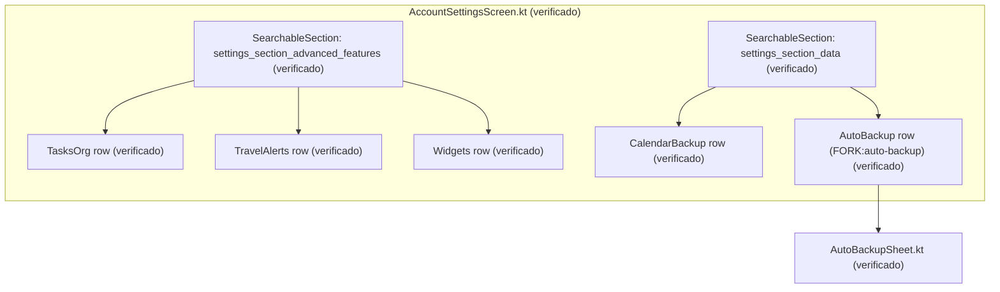
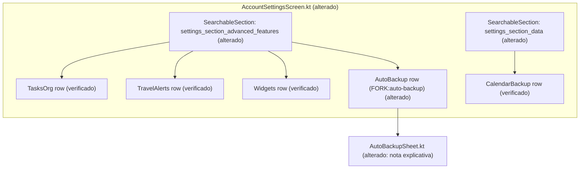

# Design & Technical Plan

## Context & Architecture Grounding
- **Fontes Arquiteturais**: `AGENTS.md`, `docs/agents/architecture.md`, `docs/fork/FORK_INTEGRATION.md`.
- **Regras de Camadas**: UI (Compose) → ViewModels → Repositórios/DataStore.
- **Invariante de Fork**: Marcador `// FORK:auto-backup` preservado e restrito ao ponto de enxerto da UI e das preferências.
- **Tier**: `light` (reorganização pontual de layout Compose e textos explicativos).

## Goals / Non-Goals

**Goals:**
- Mover a linha de configuração de `auto-backup` para a seção de recursos avançados (`settings_section_advanced_features`) em `AccountSettingsScreen.kt`.
- Deixar a seção de dados (`settings_section_data`) 100% fiel ao upstream KashCal.
- Adicionar nota informativa em `AutoBackupSheet.kt` sobre o backup incluir preferências do fork.
- Atualizar asserções de testes unitários em Compose.

**Non-Goals:**
- Modificar o worker (`AutoBackupWorker.kt`) ou o agendador (`AutoBackupScheduler.kt`).
- Alterar exportação de arquivos `.ics` ou o backup de calendários offline (`CalendarBackupRunner.kt`).

## AS IS — Estado e Componentes Atuais

Na arquitetura atual, `AutoBackup` reside dentro de `settings_section_data`, competindo com `CalendarBackup` do upstream.

## TO BE — Estado e Componentes Propostos

A linha de `AutoBackup` é movida para `settings_section_advanced_features` (RF-03), mantendo `settings_section_data` restrita ao upstream.

## RIGID vs FLEXIBLE Boundaries
- **RIGID (Invariantes Inegociáveis)**:
  - Manter sentinela `// FORK:auto-backup` intacta em `AccountSettingsScreen.kt`.
  - Não alterar chaves de DataStore nem serializadores JSON.
  - Sincronizar strings novas/modificadas em `values`, `values-pt` e `values-pt-rBR`.
- **FLEXIBLE**:
  - Posição exata da linha dentro do bloco de recursos avançados (recomendado: após widgets experimentais).

## Decisions
1. **Posicionamento**: Inserir a linha de backup de configurações como último item de recursos avançados, consolidando todas as adições do fork no mesmo bloco.
2. **Textos**: Manter os mesmos rótulos e rotas (`onOpenAutoBackup`), garantindo zero quebra de contratos de navegação.

## Risks / Trade-offs
| Risk | Blast Radius | Mitigation | Rollback |
|---|---|---|---|
| Quebra de testes de UI que buscam a linha em ordem prévia | Baixo (testes locais falham) | Atualizar nós de busca nos testes de UI | Reverter commits de teste |
