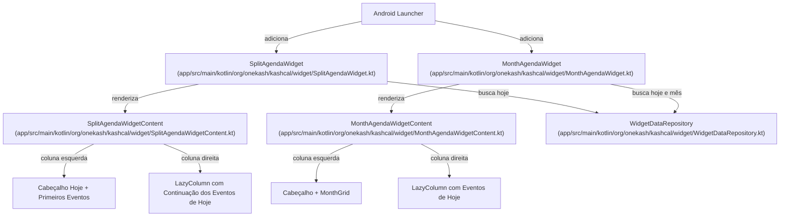
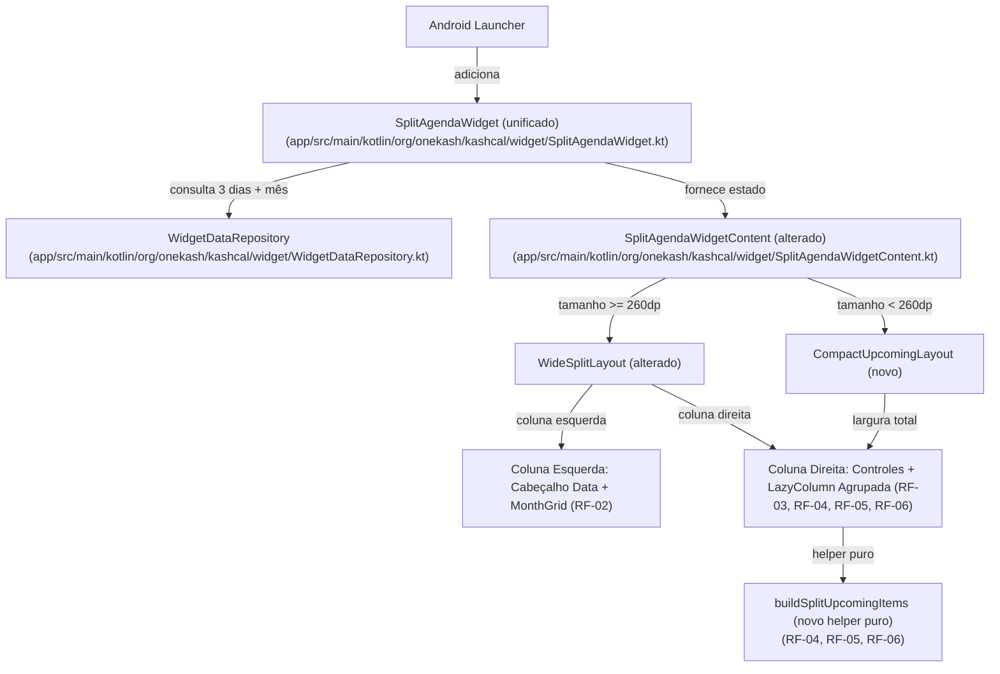

# Design & Technical Plan

## Context & Architecture Grounding
- **Fontes Arquiteturais**: `AGENTS.md`, `docs/agents/architecture.md`, `docs/agents/domain_rules.md`.
- **Regras de Camadas & Invariantes**:
  - UI (Glance AppWidget / Compose) -> Domain (`DisplayEventRepository`) -> Data (Room, DataStore).
  - Tarefas do Tasks.org permanecem estritamente não persistidas no Room, consumidas sob demanda via ContentProvider e expostas como `DisplayEvent.Task` / `WidgetEvent(isTask = true)`.
  - Preferências do usuário (`widgetMaxEventsPerDay`, `widgetDetailedRows`, `firstDayOfWeek`) são consumidas de forma reativa a partir de `KashCalDataStore`.

## Goals / Non-Goals

**Goals:**
- Unificar as funcionalidades dos widgets experimentais do fork em um único widget avançado (`SplitAgendaWidget`).
- Eliminar integralmente o widget redundante `MonthAgendaWidget` do código-fonte, manifesto e configurações.
- Prover na coluna esquerda de `SplitAgendaWidget` (quando em modo wide) o cabeçalho completo de data e a grade do mês atual com indicadores (dots) de eventos.
- Concentrar na coluna direita de `SplitAgendaWidget` a lista de eventos com filtragem de eventos passados e agrupamento inteligente por data (Hoje, Amanhã, Amanhã+1).
- Suportar responsividade fluida: em telas ou posições estreitas (< 260dp), ocultar a coluna esquerda e renderizar apenas a coluna direita agrupada em largura total.
- Respeitar estritamente as preferências upstream de limite diário (`widgetMaxEventsPerDay` nos dias futuros) e estilo de linha (`widgetDetailedRows`).

**Non-Goals:**
- Não alterar os widgets upstream padrão (`AgendaWidget`, `UpcomingWidget`, `MonthWidget`, `WeekWidget`).
- Não persistir estado ou cache de tarefas em Room Database.
- Não introduzir dependências ou serviços externos de sincronização além dos já existentes.

## AS IS — Estado e Componentes Atuais

Dois widgets separados no fork atendem a casos de uso concorrentes (`SplitAgendaWidget` e `MonthAgendaWidget`), gerando duplicação de componentes, de lógica no repositório e confusão no seletor de widgets.

## TO BE — Estado e Componentes Propostos

O componente `MonthAgendaWidget` é integralmente excluído (RF-01). O `SplitAgendaWidget` unificado consulta os eventos da janela de 3 dias e a grade mensal, alternando responsivamente entre o layout dual-column (grid mensal + lista agrupada) e layout compacto (apenas lista agrupada com ações).

## RIGID vs FLEXIBLE Boundaries

- **RIGID (Não Negociável)**:
  - **Eliminação Completa de Legado**: `MonthAgendaWidget`, `MonthAgendaWidgetReceiver` e seus layouts correspondentes devem ser excluídos. Nenhuma chamada residual ou declaração no manifesto pode permanecer.
  - **Breakpoint de Responsividade**: A alternância entre o modo de duas colunas e coluna única ocorre exatamente no limite de 260dp (`size.width >= 260.dp`), consistente com os padrões de grid Glance do app.
  - **Janela e Filtragem Temporal**: A lista de próximos eventos abrange estritamente 3 dias (`today`, `today + 1`, `today + 2`). Eventos passados do dia corrente (`isPast == true`) são obrigatoriamente filtrados e não aparecem.
  - **Seção Hoje Incondicional**: A seção "Hoje" é sempre renderizada na lista; caso não haja eventos pendentes para hoje, ela exibe explicitamente a mensagem "Nenhum evento hoje".
  - **Respeito aos Limites Upstream**: Todos os eventos restantes de hoje são exibidos; os dias futuros são limitados individualmente a `widgetMaxEventsPerDay`; o layout de cada item respeita `widgetDetailedRows`.
  - **Não Persistência**: Tarefas do Tasks.org continuam sendo apenas mapeadas para exibição e toggle interativo, sem persistência no Room.

- **FLEXIBLE (Autonomia de Implementação)**:
  - Modelagem exata das classes de itens da lista (ex.: `SplitAgendaListItem.Header`, `SplitAgendaListItem.EventRow`, `SplitAgendaListItem.EmptyTodayNotice`).
  - Organização de arquivos internos: o helper de agrupamento e formatação de datas pode residir em um arquivo utilitário dedicado (`SplitAgendaGrouping.kt`) para facilitar testes unitários com JUnit 4 puro, desacoplados do Compose Glance.
  - Nomes das strings nos arquivos de recursos, desde que devidamente sincronizados entre `values`, `values-pt` e `values-pt-rBR`.

## Decisions

- **Decisão 1: Helper de Agrupamento Puro e Desacoplado**:
  - *Contexto*: Testar renderização de Glance AppWidgets em testes unitários locais é complexo devido a dependências de RemoteViews.
  - *Escolha*: Isolar a lógica de processamento de datas, filtro de passados, limite por dia e montagem de itens agrupados em uma função pura (`buildSplitUpcomingItems`), recebendo `eventsByDay`, `todayDayCode`, `nowMs`, `maxEventsPerDay`.
  - *Alternativa rejeitada*: Implementar a lógica proceduralmente dentro do Composable Glance, o que tornaria impossível testar exaustivamente cenários de borda (ex.: 23:43, viradas de mês, dias intermediários sem eventos).

- **Decisão 2: Remoção Total do MonthAgendaWidget em vez de Depreciação**:
  - *Contexto*: Os widgets do fork são experimentais e destinados a evoluir sem carregar dívida técnica de compatibilidade com versões obsoletas do fork.
  - *Escolha*: Excluir diretamente todas as classes e referências no manifesto e na interface de configurações.
  - *Alternativa rejeitada*: Manter o widget como redirect ou vazio, o que geraria confusão visual no launcher do Android e poluição de código.

- **Decisão 3: Reuso da Grade `MonthGrid`**:
  - *Contexto*: O cálculo e desenho dos dias do mês com destaque circular e dots já foram estabilizados no `MonthAgendaWidgetContent.kt`.
  - *Escolha*: Mover e incorporar a renderização do grid mensal diretamente no layout esquerdo de `SplitAgendaWidgetContent.kt` ou em um composable auxiliar reaproveitável, alimentado por `firstDayOfWeek` vindo do `KashCalDataStore`.

## Capability Reuse Validation
<!-- Perfil pessoal (ignore_for_this_run): validação de reúso corporativo omitida -->

## Risks / Trade-offs

| Risk | Blast Radius | Mitigation | Rollback |
|---|---|---|---|
| Usuário possuía `MonthAgendaWidget` na tela inicial | O launcher exibirá widget indisponível ou erro de carregamento | Como se trata de widget experimental do fork, a tela de configurações documentará o widget unificado. | Reversão via Git do commit de remoção do receiver caso necessário. |
| Excesso de itens no RemoteViews exceder o limite do Binder (1MB) | Widget pode travar em `widget_loading.xml` | A janela é estritamente limitada a 3 dias (Hoje + 2 dias) e os dias futuros são limitados por `widgetMaxEventsPerDay`, contendo o payload bem abaixo de 200KB. | Reduzir `maxEventsPerDay` padrão ou truncar `eventsByDay`. |
| Inconsistência de strings em idiomas adicionais | Falhas de compilação de recursos de strings | Utilizar o script `app/src/fork/tools/gen_strings_pt.py` ou atualizar paritariamente `values`, `values-pt` e `values-pt-rBR`. | Correção direta nos arquivos XML. |

## Open Questions
- Nenhuma pendência em aberto. Todos os requisitos, comportamentos em limites de data e responsividade foram confirmados.
